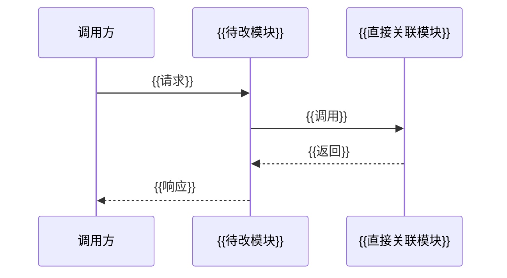

<!--
增量架构模板（delta-arch.md）· 使用说明（注释不可见，可删除）
1. 只分析**本次待修改的模块**与**它们的直接关联模块**，不做全量架构盘点
2. 时序图与 UML 图是必需的；上下文图、部署图、数据模型只在本次确实牵动时才画
3. 全局替换 {{双花括号}} 占位符；节点 ID 用英文，中文显示名放引号里
4. 本文件随变更走，收尾时并入 docs/arch.md 的标记块
-->

# {{CHANGE_NAME}} 增量架构分析

## 变更背景

<!-- 一段话：这次动什么、为什么动。需求细节见 delta-spec.md，这里不重复。 -->

## 待修改模块

| 模块 | 现有职责 | 本次改动 | 影响面 |
|---|---|---|---|
| `{{src/api/query}}` | {{查询编排}} | {{新增金额区间筛选}} | {{单文件，无对外接口变化}} |

## 直接关联模块

<!-- 只列与上面那些模块有直接调用/依赖关系的，不扩到二跳。 -->

| 模块 | 与待改模块的关系 | 本次是否要动 | 理由 |
|---|---|---|---|
| `{{src/api/export}}` | {{被 query 调用}} | {{否}} | {{入参不变，行为不变}} |

## 接口与依赖变化

<!-- 新增/修改/删除的接口签名、事件、数据契约；没有就写「无」。 -->

## 时序图（必需）

<!-- 画本次改动涉及的关键调用链，参与者只保留真正参与的模块。 -->



## UML 图（必需）

<!-- 类图或组件图，二选一或都给：说明改动后的结构与关系。 -->

```mermaid
classDiagram
    class {{QueryService}} {
        +{{filterByAmount(range)}}
    }
    {{QueryService}} --> {{Repository}}
```

## 其他视图（按需）

<!-- 部署图 / 系统上下文图 / 数据模型：本次确实牵动才画，否则整节删掉。 -->

## 对整体架构的影响

<!-- 会不会改变既有分层、依赖方向、部署形态；没有就明确写「无结构性影响」。 -->

## 风险与回滚

<!-- 改动失败时怎么退回去；对关联模块有什么连带风险。 -->
