<!--
============================================================
系统架构设计文档模板（arch.md）· 使用说明（注释不可见，可删除）
1. 全局替换所有 {{双花括号}} 占位符为真实信息
2. 所有 Mermaid 图均为完整可渲染语法：节点 ID 保持英文或拼音，
   中文显示名写在引号内，替换时只改引号里的内容和图结构
3. 标注「可选」的小节用不上时整节删除，并同步更新目录
4. 视图分离：上下文图给管理层与产品看，分层图/时序图给开发看，
   部署图给运维看；不要试图用一张图表达所有信息
5. 渲染方式：GitHub / GitLab 原生支持；本地可用 VS Code
   （Markdown Preview Mermaid Support 插件）、Typora、Obsidian、语雀
============================================================
-->

# {{PROJECT_NAME}} 系统架构设计文档

| 项目 | 内容 |
|---|---|
| 文档版本 | v1.0 |
| 编写人 | {{AUTHOR}} |
| 评审人 | {{REVIEWER}} |
| 最后更新 | {{YYYY-MM-DD}} |
| 文档状态 | 草稿 / 评审中 / 已定稿 |
| 文档密级 | 内部公开 |

## 变更记录

| 版本 | 日期 | 修改人 | 变更说明 |
|---|---|---|---|
| v1.0 | {{YYYY-MM-DD}} | {{AUTHOR}} | 初稿创建 |
|  |  |  |  |

## 目录

- [1. 引言与背景](#1-引言与背景)
- [2. 架构设计原则与约束](#2-架构设计原则与约束)
- [3. 业务架构与系统上下文](#3-业务架构与系统上下文)
- [4. 逻辑架构与技术选型](#4-逻辑架构与技术选型)
- [5. 核心业务流程](#5-核心业务流程)
- [6. 核心数据架构](#6-核心数据架构)
- [7. 物理部署与网络架构](#7-物理部署与网络架构)
- [8. 非功能性需求设计](#8-非功能性需求设计)
- [9. 架构演进与风险评估](#9-架构演进与风险评估)
- [10. UML 视图](#10-uml-视图)
- [附录](#附录)

## 1. 引言与背景

### 1.1 编写目的

本文档描述 {{PROJECT_NAME}} 的整体架构设计，包括业务边界、逻辑分层、核心流程、数据模型、部署形态与非功能设计，作为开发、测试、运维与后续演进的技术依据。

不同读者的阅读建议：

| 读者 | 建议章节 | 关注重点 |
|---|---|---|
| 技术管理层 | 1、2、9 | 建设目标、约束条件、演进节奏与风险 |
| 产品 / 业务方 | 1、3 | 业务背景、系统边界与外部依赖 |
| 开发团队 | 2、4、5、6 | 分层职责、技术选型、核心链路与数据模型 |
| 测试团队 | 2、5、8 | 异常链路、性能与可用性指标 |
| 运维团队 | 7、8.1、8.4 | 部署拓扑、容灾切换与可观测性 |

### 1.2 业务背景

{{说明项目立项的业务背景：当前业务处于什么阶段、遇到什么核心痛点、为什么现有方案无法支撑。可给出量化的现状数据，如订单峰值、人工处理成本、系统故障频次。}}

### 1.3 核心目标

| 编号 | 目标 | 量化指标 | 验证方式 |
|---|---|---|---|
| G1 | {{支撑业务增长}} | {{日活 100 万，峰值 QPS 5000}} | {{全链路压测报告}} |
| G2 | {{交易体验}} | {{核心接口 P99 < 200ms}} | {{APM 监控大盘}} |
| G3 | {{系统稳定性}} | {{可用性 99.99%，年故障时长 < 53 分钟}} | {{月度 SLA 报表}} |
| G4 | {{可维护性}} | {{新增一个业务域 ≤ 3 人日}} | {{迭代交付记录}} |

> 目标必须是可验证的量化指标，避免「高性能」「高可用」这类无法验收的表述。

### 1.4 术语表

| 术语 | 全称 / 英文 | 说明 |
|---|---|---|
| {{SKU}} | {{Stock Keeping Unit}} | {{最小库存单元}} |
| {{MQ}} | {{Message Queue}} | {{异步消息中间件}} |
| {{CDC}} | {{Change Data Capture}} | {{数据库变更捕获，用于数据同步}} |

## 2. 架构设计原则与约束

### 2.1 设计原则

- **高可用优先**：核心链路不依赖单点，任何单个组件故障不导致整体不可用。
- **面向失败设计**：默认所有外部依赖都会失败，超时、重试、熔断、降级必须显式声明。
- **无状态化**：服务实例不保存会话状态，支持水平扩容与快速重建。
- **演进式架构**：一期满足当前量级并预留扩展点，避免过度设计。
- **边界清晰**：按业务域拆分服务，跨域只通过接口或消息交互，禁止直连对方数据库。
- **可观测性内建**：日志、指标、链路追踪随服务一同交付，不接受「先上线再补监控」。

### 2.2 约束条件

| 类型 | 约束 | 对架构的影响 |
|---|---|---|
| 技术栈 | {{团队主力语言为 Java / Go，数据库统一 MySQL + Redis}} | {{不引入无成熟运维经验的新中间件}} |
| 预算与资源 | {{初期云资源预算有限，需控制成本}} | {{优先复用存量集群，新组件需评估 TCO}} |
| 合规与安全 | {{需满足等保三级，敏感数据加密存储}} | {{审计日志、加密字段、权限模型为强制项}} |
| 人力与时间 | {{一期 3 个月内交付 MVP}} | {{优先单体分模块，二期再拆分微服务}} |

## 3. 业务架构与系统上下文

### 3.1 系统上下文图

展示本系统与外部用户、第三方系统之间的边界与交互关系。

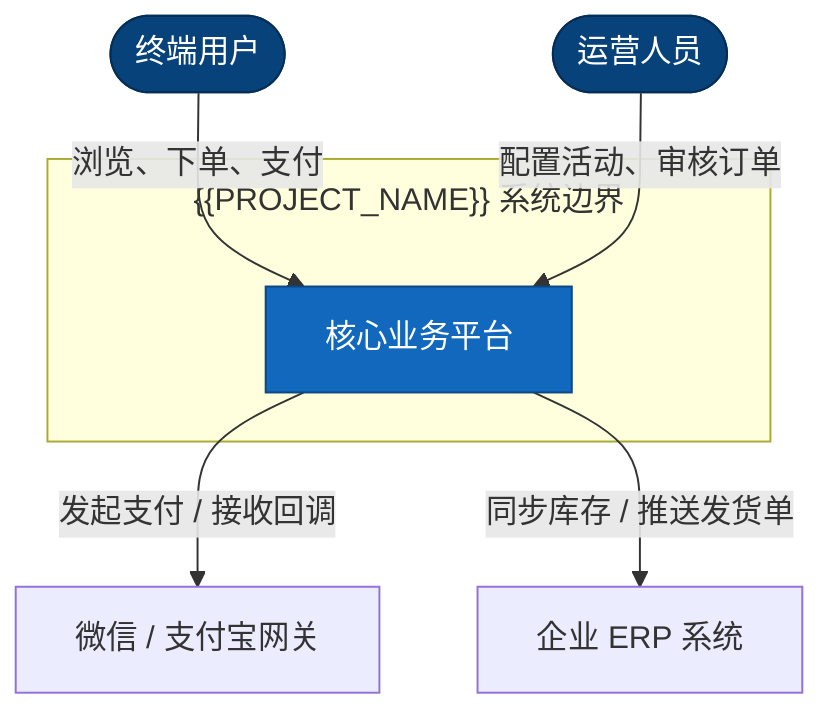

**外部依赖说明**：

| 外部系统 | 交互方式 | 依赖强度 | 故障影响与应对 |
|---|---|---|---|
| {{支付网关}} | {{同步调用 + 异步回调}} | 强 | {{支付不可用则下单降级为货到付款}} |
| {{ERP}} | {{定时同步 + 消息}} | 弱 | {{同步延迟不影响主流程，可补偿}} |

### 3.2 业务能力全景图

<!-- 可选小节：用于说明系统承载了哪些业务能力，适合给管理层与产品方对齐范围 -->

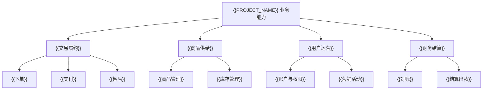

### 3.3 业务域划分

| 业务域 | 核心职责 | 承载服务 | 主要依赖 |
|---|---|---|---|
| {{交易域}} | {{下单、履约、售后}} | {{订单服务、履约服务}} | {{商品域、支付域}} |
| {{商品域}} | {{商品管理、库存}} | {{商品服务、库存服务}} | {{搜索、缓存}} |
| {{用户域}} | {{账号、权限、画像}} | {{用户中心}} | {{Redis、MySQL}} |

## 4. 逻辑架构与技术选型

### 4.1 分层与模块架构图

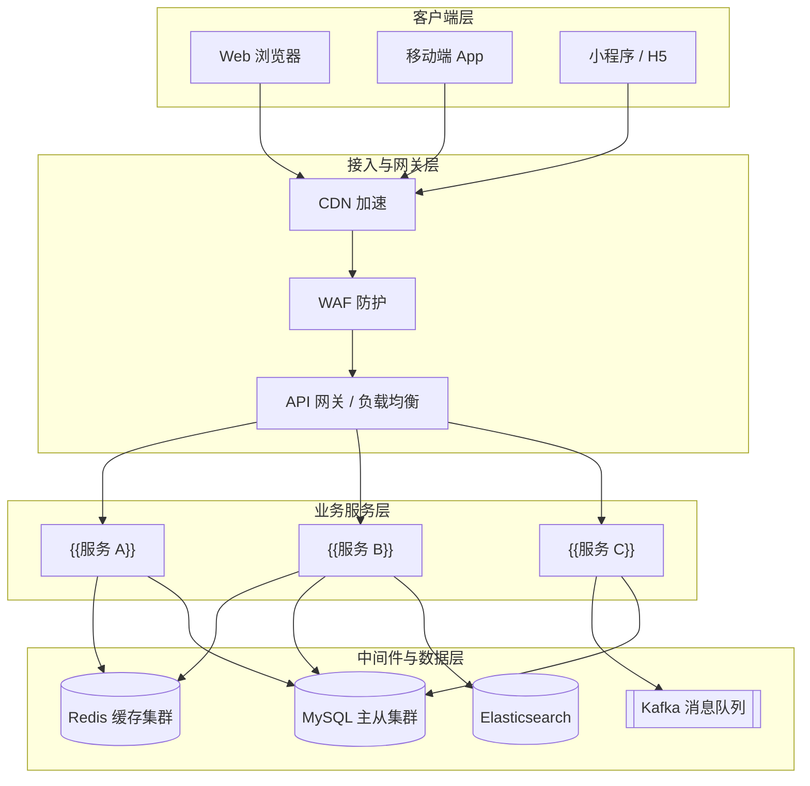

各层职责与关键约束：

| 层级 | 职责 | 关键约束 |
|---|---|---|
| 客户端层 | {{交互与展示}} | {{不承载业务规则，接口版本向后兼容}} |
| 接入与网关层 | {{路由、鉴权、限流}} | {{单点故障需双活，限流阈值按业务域配置}} |
| 业务服务层 | {{核心业务逻辑}} | {{无状态，跨域仅通过接口或消息}} |
| 中间件与数据层 | {{存储、缓存、异步通信}} | {{主从 + 备份，缓存需定义失效策略}} |

### 4.2 核心技术栈选型表

| 类别 | 选型方案 | 选型理由 |
|---|---|---|
| 开发语言 / 框架 | {{Go (Gin) / Java (Spring Cloud)}} | {{团队技术沉淀深，生态成熟，高并发性能可预期}} |
| API 网关 | {{APISIX / Kong}} | {{支持动态路由、限流熔断、JWT 鉴权，性能损耗低}} |
| 关系型数据库 | {{MySQL 8.0}} | {{强一致性，适合交易与账户类核心数据}} |
| 缓存中间件 | {{Redis Cluster}} | {{支撑高并发读与分布式锁，具备成熟运维方案}} |
| 消息队列 | {{Apache Kafka}} | {{高吞吐、可回放，用于状态流转与日志削峰}} |

### 4.3 关键架构决策与取舍

> 不只写「用了什么」，必须写清「为什么不用替代方案」。重要决策建议单独归档为 ADR。

| 决策点 | 备选方案 | 最终选择 | 理由 | 代价 / 影响 |
|---|---|---|---|---|
| {{服务间通信}} | {{同步 RPC / 消息队列}} | {{核心链路同步 RPC，非核心走消息}} | {{同步保证一致性，异步换吞吐与解耦}} | {{需维护两套通信契约与重试逻辑}} |
| {{订单状态流转}} | {{直接 RPC 调用下游 / Kafka}} | {{Kafka}} | {{削峰填谷，下游故障不阻塞下单}} | {{最终一致，需补偿与对账机制}} |
| {{商品查询}} | {{每次查库 / 多级缓存}} | {{本地缓存 + Redis}} | {{热点商品读放大明显}} | {{缓存一致性需延迟双删}} |

## 5. 核心业务流程

### 5.1 核心链路时序图

以 {{下单支付}} 流程为例，展示运行时调用顺序。

```mermaid
sequenceDiagram
    autonumber
    actor user as 用户
    participant gw as API 网关
    participant order as {{订单服务}}
    participant stock as {{库存服务}}
    participant cache as Redis
    participant mq as 消息队列

    user->>gw: 提交订单请求
    gw->>order: 鉴权通过，转发请求
    activate order
    order->>cache: 获取分布式锁（防重复提交）
    cache-->>order: 加锁成功
    order->>stock: 预扣减库存（RPC 调用）
    activate stock
    stock-->>order: 扣减成功
    deactivate stock
    order->>order: 创建本地订单（状态：待支付）
    order->>mq: 发送延迟关单消息（30 分钟超时）
    order-->>gw: 返回订单号与支付参数
    deactivate order
    gw-->>user: 跳转收银台
```

**关键点说明**：

- {{为什么在第 3 步加分布式锁：防止用户重复点击造成超卖与重复订单}}
- {{为什么关单走延迟消息而非定时轮询：避免扫表压力，超时精度可接受}}

### 5.2 关键异常与补偿

<!-- 可选小节：异常链路最能体现设计深度，建议至少覆盖核心链路的失败分支 -->

| 异常场景 | 检测方式 | 补偿 / 降级策略 | 用户感知 |
|---|---|---|---|
| {{库存扣减成功、订单创建失败}} | {{本地事务 + 消息回查}} | {{释放库存，消费失败重试 3 次后进死信队列}} | {{提示重试，无资金损失}} |
| {{支付回调丢失}} | {{定时对账任务}} | {{主动查询支付状态并回写订单}} | {{订单状态延迟更新}} |
| {{下游服务超时}} | {{熔断器统计}} | {{返回兜底数据或排队稍后处理}} | {{降级提示}} |

## 6. 核心数据架构

### 6.1 核心实体关系图

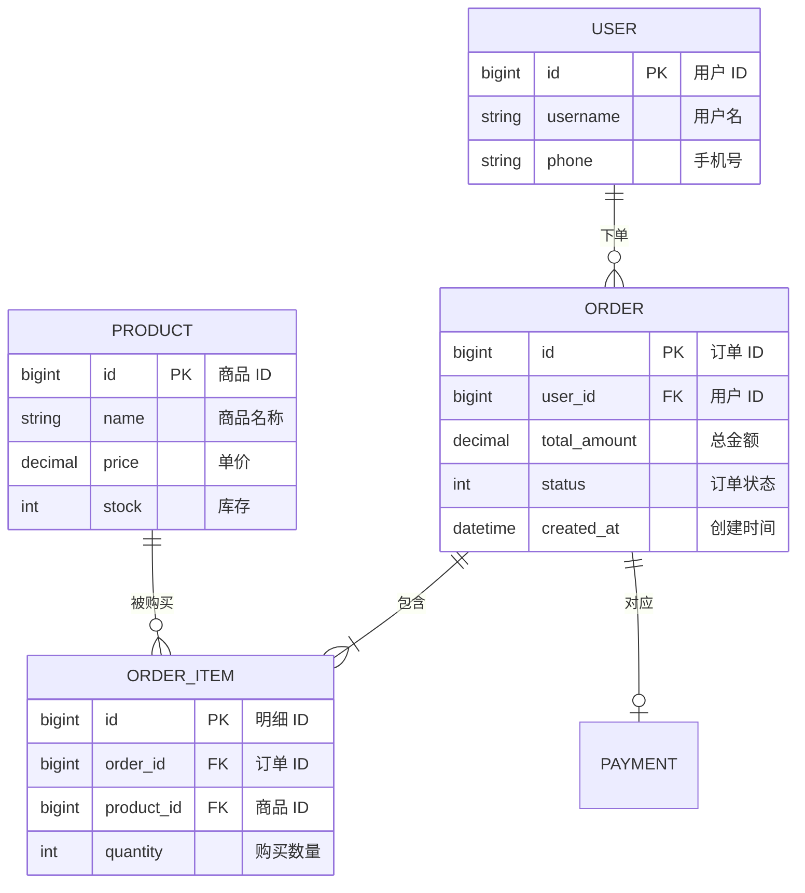

<!-- 上图为语法示例，请替换为你的核心实体；实体名用英文或拼音，注释写在引号内 -->

### 6.2 存储与数据流转策略

| 数据对象 | 存储介质 | 预估量级 | 分片 / 归档策略 |
|---|---|---|---|
| {{订单主表}} | {{MySQL}} | {{日均 50 万行，年增 1.8 亿}} | {{按 user_id 哈希分 16 库，历史 13 个月归档}} |
| {{商品热点数据}} | {{Redis}} | {{约 200 万 key}} | {{按类目分片，TTL 30 分钟 + 主动刷新}} |
| {{行为日志}} | {{Kafka → 数仓}} | {{日均 10 亿条}} | {{保留 7 天，冷数据转对象存储}} |

### 6.3 数据一致性策略

<!-- 可选小节 -->

- **强一致场景**：{{账户扣款、库存扣减}}，采用本地事务 + 唯一约束保证幂等。
- **最终一致场景**：{{订单状态同步、积分发放}}，通过消息 + 对账任务收敛。
- **幂等设计**：{{所有消息消费者以业务唯一键去重，写操作带版本号或状态机校验。}}
- **对账机制**：{{T+1 全量对账，差异自动告警并进入人工处理队列。}}

## 7. 物理部署与网络架构

### 7.1 生产环境部署架构图

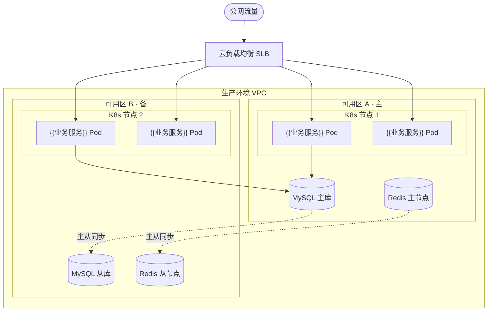

### 7.2 环境与资源规划

| 环境 | 用途 | 规格 | 数量 | 备注 |
|---|---|---|---|---|
| 开发 | {{联调}} | {{2C4G}} | {{2}} | {{单实例，共享中间件}} |
| 预发 | {{回归与压测}} | {{4C8G}} | {{2}} | {{与生产同构，数据脱敏}} |
| 生产 | {{对外服务}} | {{8C16G}} | {{4}} | {{双可用区，跨区容灾}} |

### 7.3 网络与安全边界

<!-- 可选小节 -->

- **域名与证书**：{{对外域名统一走 HTTPS，证书自动续期。}}
- **网络分区**：{{公网仅暴露 SLB，业务 Pod 位于私有子网，数据库不出公网。}}
- **访问控制**：{{安全组按最小权限开放，运维入口仅跳板机可达并留审计。}}

## 8. 非功能性需求设计

### 8.1 高可用与容灾

| 风险场景 | 应对措施 | 目标 RTO / RPO |
|---|---|---|
| {{单节点 / 单 Pod 故障}} | {{K8s 多副本 + 健康探针自动拉起}} | {{RTO < 1 分钟}} |
| {{数据库主库故障}} | {{主从切换 + 切换演练每季度一次}} | {{RTO < 5 分钟，RPO ≈ 0}} |
| {{可用区整体故障}} | {{双 AZ 部署，流量自动切至备区}} | {{RTO < 15 分钟}} |
| {{第三方依赖不可用}} | {{熔断 + 降级兜底，非核心功能可关闭}} | {{核心链路不受影响}} |

### 8.2 高并发与性能优化

- **多级缓存**：{{本地缓存（热点配置）→ Redis（业务数据）→ DB，逐级回源并设置穿透保护。}}
- **读写分离**：{{查询走从库，写与事务走主库；主从延迟超过阈值时强制回主。}}
- **分库分表**：{{订单按 user_id 哈希分片，避免跨分片事务，统计走数仓。}}
- **异步化**：{{非核心链路（通知、积分、日志）全部改为消息驱动。}}

压测基线：

| 场景 | 目标 QPS | P99 延迟 | 错误率 |
|---|---|---|---|
| {{下单}} | {{3000}} | {{< 200ms}} | {{< 0.1%}} |
| {{商品详情}} | {{8000}} | {{< 50ms}} | {{< 0.1%}} |

### 8.3 安全性设计

- **传输安全**：{{全站 HTTPS，内部服务间 mTLS 或内网白名单。}}
- **存储安全**：{{手机号、身份证等敏感字段 AES 加密落库，密钥独立托管。}}
- **访问控制**：{{RBAC 权限模型，接口级鉴权，管理端独立域名与二次认证。}}
- **防刷与风控**：{{网关限流 + 频控 + 设备指纹，异常行为实时拦截。}}
- **审计**：{{关键操作全量留痕，日志保留 ≥ 6 个月。}}

### 8.4 可观测性

| 维度 | 工具 | 采集内容 | 告警阈值 |
|---|---|---|---|
| 日志 | {{ELK / Loki}} | {{应用日志、访问日志}} | {{错误日志 5 分钟内 > 10 条}} |
| 指标 | {{Prometheus + Grafana}} | {{QPS、延迟、错误率、资源使用}} | {{P99 > 200ms 持续 5 分钟}} |
| 链路追踪 | {{SkyWalking / Jaeger}} | {{跨服务调用链、慢调用}} | {{单链路耗时 > 1s}} |

### 8.5 容量评估与扩容

<!-- 可选小节 -->

| 指标 | 当前水位 | 扩容触发阈值 | 扩容方式 |
|---|---|---|---|
| {{CPU}} | {{日常 30%，峰值 60%}} | {{持续 > 70%}} | {{HPA 自动扩 Pod}} |
| {{数据库连接}} | {{峰值 60%}} | {{> 80%}} | {{升配或拆分只读库}} |

## 9. 架构演进与风险评估

### 9.1 演进路线图

| 阶段 | 时间窗 | 架构形态 | 关键动作 | 验证指标 |
|---|---|---|---|---|
| 一期（MVP） | {{第 1–3 月}} | {{单体分模块 + 主从}} | {{核心链路跑通，先保证正确性}} | {{核心功能可用，压测达标}} |
| 二期（性能） | {{第 4–9 月}} | {{服务拆分 + 缓存/消息}} | {{热点服务独立部署，读写分离}} | {{QPS 提升至 5000}} |
| 三期（多活） | {{第 10–18 月}} | {{同城双活 / 单元化}} | {{流量调度、数据双向同步}} | {{RTO < 15 分钟}} |

### 9.2 潜在风险与应对

| 风险项 | 触发条件 | 影响 | 应对措施 | 责任人 |
|---|---|---|---|---|
| {{数据库单点}} | {{主库宕机}} | {{写入中断}} | {{主从自动切换 + 季度演练}} | {{DBA}} |
| {{消息积压}} | {{下游消费变慢}} | {{状态延迟}} | {{监控 Lag，扩容消费者，必要时降级}} | {{服务负责人}} |
| {{第三方接口限流}} | {{大促流量}} | {{支付失败率升高}} | {{多通道切换 + 本地队列缓冲}} | {{架构组}} |

### 9.3 技术债务台账

<!-- 可选小节：把已知的「临时方案」显式登记，避免被默认成正式设计 -->

| 债务项 | 来源 | 影响 | 偿还计划 |
|---|---|---|---|
| {{订单表未分片}} | {{一期赶工期}} | {{单表超 5000 万行后写入变慢}} | {{二期完成分库分表改造}} |
| {{配置硬编码}} | {{快速上线}} | {{多环境切换易出错}} | {{三期迁移至配置中心}} |

## 10. UML 视图

本章集中提供架构文档常用的 UML 视图。Mermaid 原生支持类图、状态机图与时序图（时序图见 5.1）；用例图、活动图、组件图在本模板中用 flowchart 表达同等语义，以保证在 GitHub / GitLab / Typora 中零插件渲染。若团队使用 PlantUML，可直接把这五张图迁移为严格 UML 符号。

| 视图 | UML 类型 | 所在章节 | 主要读者 |
|---|---|---|---|
| 用例图 | Use Case | 10.1 | 产品、测试 |
| 类图 | Class | 10.2 | 开发 |
| 状态机图 | State Machine | 10.3 | 开发、测试 |
| 活动图 | Activity | 10.4 | 开发、测试 |
| 组件图 | Component | 10.5 | 开发、运维 |

### 10.1 用例图

说明系统对外提供的能力边界，以及每类参与者可以使用哪些用例。

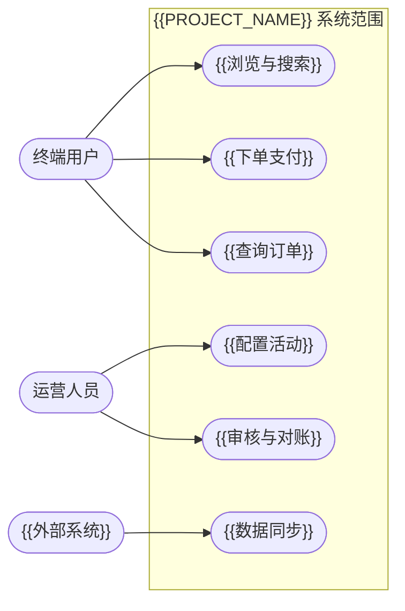

> 参与者用圆角节点表示，用例为胶囊形。需要表达 `include` / `extend` 时，增加虚线箭头 `-.->|"include"|` 指向被包含的用例即可。

### 10.2 类图

展示核心领域对象及其属性、行为与关系。下图实体与第 6 章的数据模型保持对应，替换为你的聚合根、值对象与枚举即可。

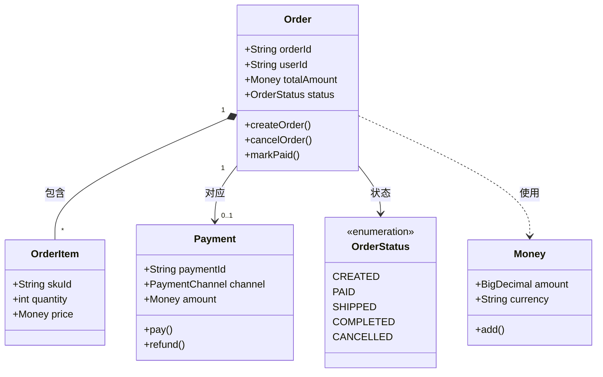

> 只画与架构决策相关的类，不必追求覆盖全部字段；重点体现聚合边界、生命周期和跨服务引用关系。

### 10.3 状态机图

以 {{订单}} 状态流转为例。每个状态都应明确进入条件、可执行动作与超时策略，避免出现无法到达或无法退出的状态。

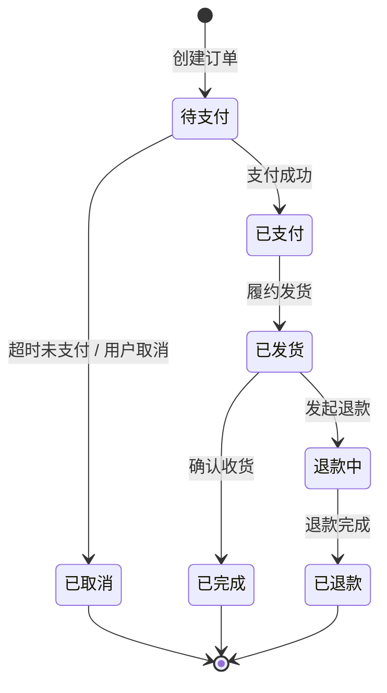

### 10.4 活动图

描述一个完整业务动作的判定分支，与 5.1 的时序图配合阅读：时序图回答「谁先调用谁」，活动图回答「在什么条件下走哪条分支」。

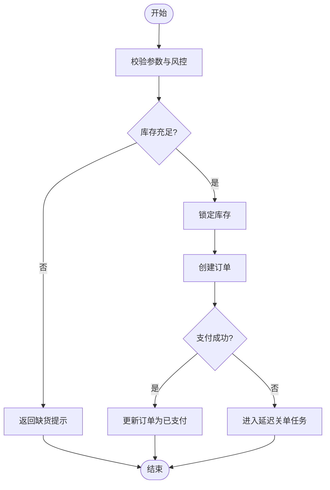

### 10.5 组件图

从可部署单元的角度展示组件边界及其对外提供的接口，比 4.1 的分层图更贴近实现与发布粒度。

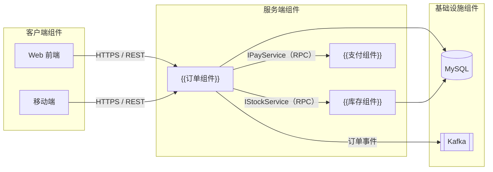

> 连线标签标注的是「提供的接口名 + 协议」，组件之间的依赖只允许通过接口，禁止跨组件直连数据库。

## 附录

### A. 参考资料

- {{《{{PROJECT_NAME}} 产品需求文档》}}：{{链接}}
- {{团队技术规范 / 接口文档}}：{{链接}}
- {{相关 ADR 归档目录}}：{{链接}}

### B. 架构评审自查清单

- [ ] 每个核心目标都有可量化指标与验证方式
- [ ] 系统上下文图的外部依赖均已列出，并标注故障影响与兜底方案
- [ ] 核心链路没有单点，关键依赖具备超时、重试、熔断与降级
- [ ] 数据模型覆盖核心实体，主键、索引与增长量级明确
- [ ] 部署图与真实环境一致，容灾切换路径可演练
- [ ] 性能、可用性、安全指标均有对应的监控与告警支撑
- [ ] 每项关键选型都说明了「为什么不用替代方案」
- [ ] 演进路线与当前版本边界清晰，未承诺超出资源与人力约束的能力

> （注：部分内容由豆包 AI 生成）