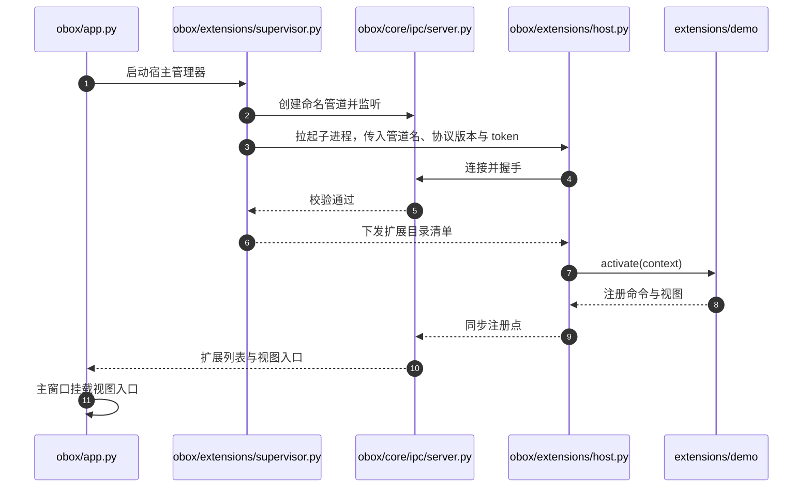
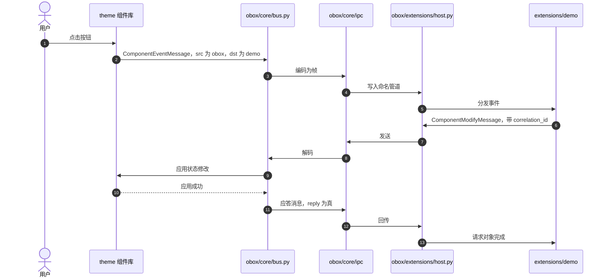
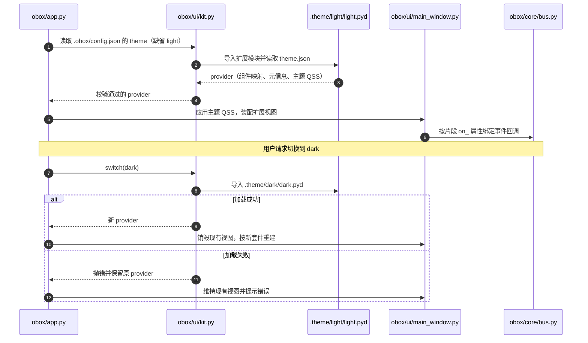
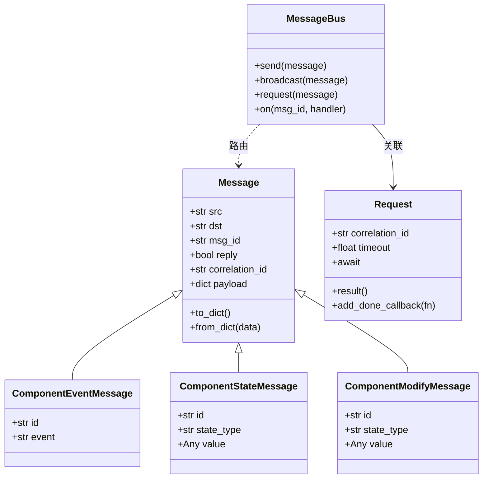
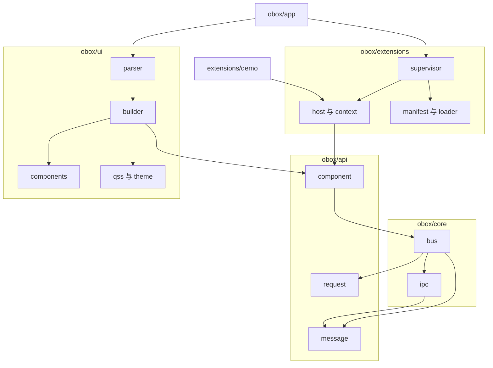
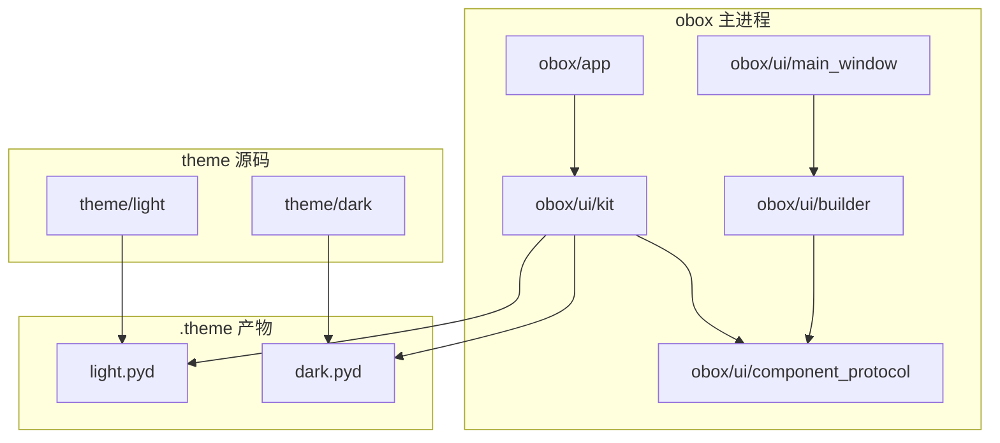

# obox UI 框架与扩展系统 增量架构分析

## 变更背景

工程当前只有入口脚本、pyproject.toml 与空的 README，没有任何可运行能力。本次要把三块地基一次落下：HTML 组件 DSL 与原生控件装配、obox 与扩展宿主之间的命名管道消息层、仿 VSCode 的扩展体系，并交付 15 个核心组件与一份示范扩展。因为工程是绿地，本文的「待修改模块」全部是新增模块；它们的契约出处是 delta-design.md 的 Changes 表，实现落地后再回填真实文件路径。

## 待修改模块

| 模块 | 现有职责 | 本次改动 | 影响面 |
|---|---|---|---|
| `obox/main.py`、`obox/app.py` | 不存在 | 新增：命令行入口、QApplication 装配、主窗口与宿主管理器的启动顺序 | 新增两个文件，对外只暴露 main 函数 |
| `obox/api/` | 不存在 | 新增：Message 基类与常量、三条组件消息、事件与状态枚举、请求对象、错误码 | 契约层，被其余三个子包依赖，自身不依赖 Qt 界面 |
| `obox/core/` | 不存在 | 新增：消息总线、订阅与关联表、帧编解码、命名管道服务端与客户端 | 运行层，被入口层与扩展层调用 |
| `obox/ui/` | 不存在 | 新增：解析器、注册表、装配器、QSS 过滤与主窗口；组件实现第二轮迁到 theme 两套库 | 表示层只保留装配与加载 |
| `obox/extensions/` | 不存在 | 新增：清单校验、目录扫描、宿主进程管理与宿主入口、context、注册表 | 扩展层，跨进程边界的唯一出口 |
| `obox/assets/obox.svg` | 不存在 | 新增：主程序图标，由 tmp/obox.svg 迁入 | 单文件，无接口 |
| `extensions/demo/` | 不存在 | 新增：示范扩展的清单、入口、图标、QSS 与 HTML 视图 | 首个扩展，验证全部主链路 |
| `tests/` | 不存在 | 新增：帧编解码、消息序列化、解析器、注册表、清单校验的单测 | 只读被测模块，不改生产代码 |
| `theme/light/`、`theme/dark/` | 不存在 | 新增：两套独立组件实现（各 15 个）、组件基类、事件与状态常量、theme.json 与主题 QSS | 源码包，编译前也可被测试直接导入 |
| `.theme/light/`、`.theme/dark/` | 不存在 | 新增：构建产物目录，放 pyd 与 theme.json | 运行期只读 |
| `obox/ui/component_protocol.py` | 不存在 | 新增：组件协议（supported_states、state_accessors、supported_events、event_methods、widget、attach、container_layout）与校验 | 表示层新增协议模块 |
| `obox/ui/kit.py` | 不存在 | 新增：theme.json 解析、pyd 加载、版本与缺失校验、运行中切换入口 | 表示层新增加载器 |
| `obox/ui/builder.py` | 装配节点树 | 修改：组件类由 provider 注入；按片段里的 on_ 属性订阅事件，按映射读写状态 | 装配器改为依赖注入与映射驱动 |
| `obox/app.py`、`obox/main.py` | 应用装配与入口 | 修改：按配置与命令行选 kit，切换时销毁并重建视图，失败回滚 | 启动与切换流程改变 |
| `scripts/build_theme.py` | 不存在 | 新增：Nuitka 编译 theme 包并复制清单 | 构建入口，需 MSVC |
| `pyproject.toml` | 声明项目名与 Python 版本，无依赖 | 修改：补齐 PySide6 与 PySide6-Fluent-Widgets 依赖、项目脚本入口、测试配置 | 影响安装与启动方式 |
| `main.py`（仓库根） | 打印 Hello 的脚手架入口 | 删除：入口统一为 python -m obox.main | 移除旧入口，避免两个启动点 |

## 直接关联模块

| 模块 | 与待改模块的关系 | 本次是否要动 | 理由 |
|---|---|---|---|
| `docs/arch.md` | 项目级架构文档，描述本次要落地的分层 | 收尾时动 | 合并 delta 时把 4.1 的模块名与 8.2 的性能改成实测结果 |
| `README.md` | 对外描述，引用 install 与目录结构 | 收尾时动 | 目录树与路线图要按实现对齐 |
| `codespec/specs/design.md` | 基线决策 D1 到 D8 | 收尾时动 | 按 delta-design 的 Baseline Diff 补 D9 到 D11，并把 Context 首行改为已实现 |
| `tmp/obox.svg` | 主程序图标源文件 | 是 | 迁入 obox/assets/obox.svg 后从 tmp 删除 |
| `.obox/config.json` | 运行期配置 | 是 | 新增 theme 字段，缺省 light |
| `pyproject.toml` | 依赖与打包配置 | 是 | 增加 Nuitka 构建依赖与 theme 包的打包声明 |
| `tests/test_app_handlers.py` 等 | 现有 96 例测试 | 是 | 改为注入假 provider，另加 pyd 集成用例 |
| `.python-version`、`.gitignore` | 运行版本与忽略规则 | 否 | 3.12 与既有忽略项已够用，新增 .venv 已覆盖 |

## 接口与依赖变化

| 接口 | 变化 | 消费方 |
|---|---|---|
| `obox.api.message.Message` | 新增：字段 src、dst、msg_id、reply、correlation_id、payload，方法 to_dict 与 from_dict | obox/core、obox/ui、obox/extensions |
| `obox.api.component` 三件套 | 新增：ComponentEventMessage、ComponentStateMessage、ComponentModifyMessage，固定 msg_id，禁止扩展派生 | 组件装配、扩展代码 |
| `obox.api.request` 请求对象 | 新增：result(timeout)、add_done_callback、await 三形态 | 扩展代码、obox 内部调用 |
| `obox.extensions.context.ExtensionContext` | 新增：extension_id、assets_dir、storage_dir、register_command、register_view、send、request | 扩展代码 |
| 命名管道协议 | 新增：握手（协议版本与 token）加 4 字节长度前缀的 JSON 帧 | obox/core/ipc 两端 |
| 进程拓扑 | 变化：从单进程变为 obox 主进程加扩展宿主子进程 | 启动、监控与退出路径 |

依赖方向保持不变的单向约定：obox/ui 与 obox/extensions 依赖 obox/api 与 obox/core，obox/core 只依赖 obox/api，obox/api 不依赖任何其他子包。

## 时序图（必需）

### 启动与扩展激活

### 组件事件与状态修改往返

### kit 加载与运行中切换

## UML 图（必需）

### 契约层类图

### 模块依赖组件图

### 组件库结构

## 对整体架构的影响

- **分层**：从「无分层」变为入口层、表示层、契约层、运行层、扩展层五层，依赖方向单向，与 docs/arch.md 的 4.1 一致。
- **依赖方向**：新增 obox/api 作为唯一共享契约，ui 与 extensions 不得反向依赖彼此；obox/core 不引入界面依赖。
- **部署形态**：从单进程变为 obox 主进程加扩展宿主子进程，新增一条命名管道与宿主生命周期管理。
- **公共接口**：新增扩展开发契约（extension.json、extension.py 的 activate 与 deactivate、ExtensionContext）与消息契约，属于对外稳定接口。
- **二跳影响**：qfluentwidgets 的许可（GPLv3）会影响分发方式；Python 解释器版本决定 PySide6 可装版本。这两点只在风险里记录，不在本次改动范围。
- **第二轮的结构变化**：表示层拆成「装配与加载」（obox/ui）与「组件实现」（theme 源码编译成的 .theme/*.pyd）两段；新增 .theme 产物目录与构建入口；依赖方向变为 obox 运行期导入 kit，kit 只依赖 PySide6 与 qfluentwidgets，不反向依赖 obox；部署形态增加「先构建再运行」一步。

## 风险与回滚

| 风险 | 触发条件 | 影响 | 应对 |
|---|---|---|---|
| 依赖安装失败 | PyPI 与本地 Python 3.12 不匹配 | 主程序无法启动 | 固定 PySide6 版本区间，失败时用纯 Qt 控件兜底并记录 |
| 管道握手时序 | 服务端未 listen 就拉起宿主 | 扩展全部加载失败 | 先 listen 再 spawn，宿主侧指数退避重连 |
| 组件 id 生命周期 | 视图重建复用旧 id | 重复渲染报冲突 | 视图销毁时按命名空间批量注销 |
| 双循环桥接 | 线程切换处异常 | 请求挂起 | 关联表超时兜底，桥接只投递不阻塞 |
| pyd 与 obox 版本不匹配 | 清单版本与契约版本不一致 | 启动失败或行为异常 | 加载前校验 theme.json 版本，不一致直接报错 |
| 运行中切换内存增长 | 反复切换套件 | 内存随切换上升 | 文档写明旧模块驻留、多次切换后建议重启 |
| 构建耗时 | 每次改组件都编译 | 开发循环变慢 | 常规测试注入假 provider，只有集成用例依赖构建 |

回滚：本次改动全部落在新增的 obox/、extensions/ 与 tests/ 目录，加上 pyproject.toml 的依赖与根 main.py 的删除。回滚即恢复 pyproject.toml、还原根 main.py 的打印入口、删除三个新增目录，工程回到只有脚手架的状态。
