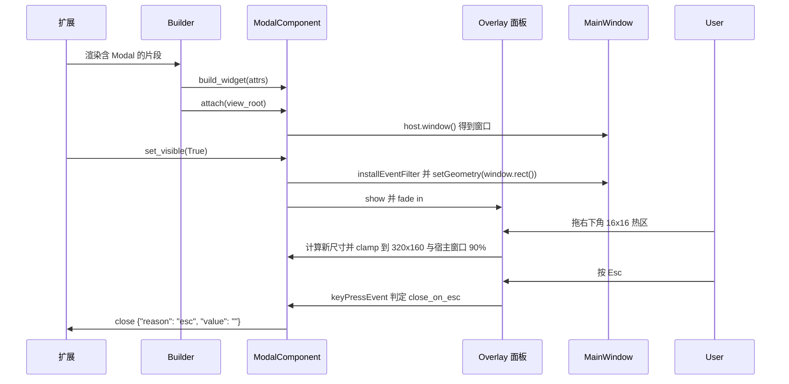
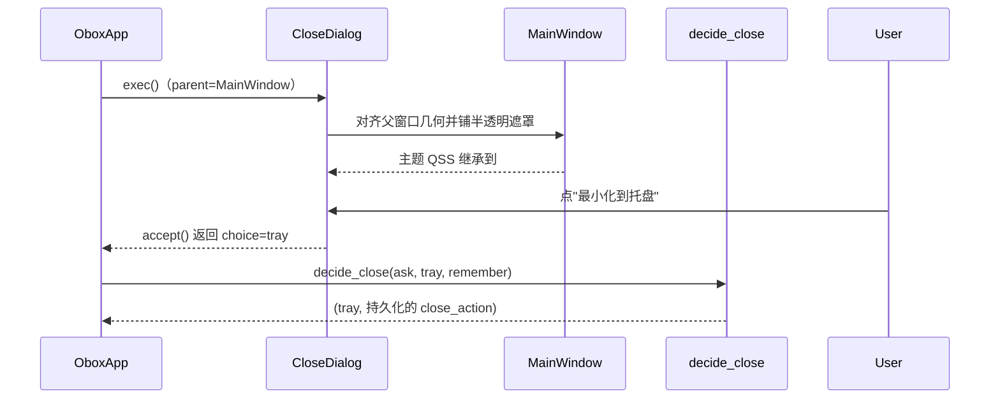
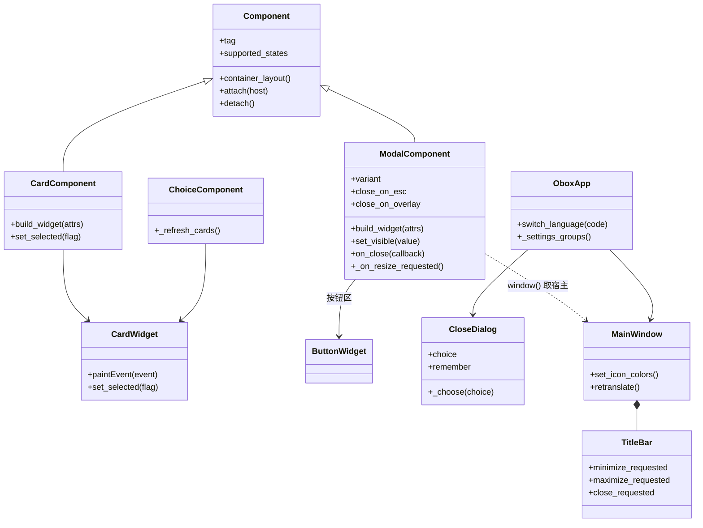

# 主题视觉美化 增量架构分析

## 变更背景

本次在三处动结构：卡片去掉对勾标签，选中态只靠自绘填充与描边；浮层由固定宽度的白底面板改为容器化面板（正文容器、按钮区、尺寸初值、右下角拖拽、Esc 与遮罩关闭、三种变体），挂载点从视图根抬到窗口；关闭询问框改用同一套面板。标题栏删掉语言入口，壳的公开方法相应收缩。需求口径见 delta-spec.md，设计清单见 delta-design.md。

## 待修改模块

| 模块 | 现有职责 | 本次改动 | 影响面 |
|---|---|---|---|
| `theme/light/components/card.py`、`theme/dark/components/card.py` | 可选中的卡片容器，自绘填充与 1px 描边，右下角 QLabel 显示对勾 | 删对勾 QLabel 与 resize 定位；`set_selected` 只改填充与描边 | 单文件，`CardWidget` 与 `CardComponent` 对外接口不变 |
| `theme/light/components/modal.py`、`theme/dark/components/modal.py` | 遮罩 + 固定 360 宽白底面板 + 标题 + 正文 + 单个"知道了"按钮 | 面板拆标题区/正文容器/按钮区；`container_layout()` 返回正文容器；读 width/height 初值与 320×160、宿主窗口 90% 上下限；右下角 16×16 拖拽；Esc 与遮罩关闭；variant 三档；无子组件时退回旧布局 | `attach()` 目标由视图根改为 `host.window()`；`close` 事件载荷从空字典变为 reason 与 value |
| `theme/light/theme.py`、`theme/dark/theme.py` | 两套 QSS 与常量，含 #obox-modal-card / title / body | 补遮罩、按钮区、变体 badge、缩放柄的 QSS；面板圆角 2px、1px 描边、无阴影 | 选择器只增不改名，旧片段不受影响 |
| `obox/ui/close_dialog.py` | 关闭询问 QDialog，内联 QSS，圆角 10 | 改无边框 + 半透明遮罩，几何对齐父窗口，内嵌 obox-modal-card 面板；保留记住勾选与三按钮，Esc 等同取消 | 构造签名与 `choice` / `remember` 字段不变；`exec()` 语义不变 |
| `obox/ui/title_bar.py` | 自绘标题栏：图标、标题、语言按钮、三个窗口按钮 | 删语言按钮、`language_requested` 信号、`set_language_label`，命中判断同步收缩 | `_on_button` 列表减少一项；窗口按钮行为不变 |
| `obox/ui/main_window.py` | 主窗口壳，持有标题栏与语言菜单 | 删 `set_languages`、`_open_language_menu`、`_choose_language` 与相关字段 | 壳的公开方法减少三个，无替代 |
| `obox/app.py` | 应用装配：注册 i18n、同步语言、应用主题 | 删 `_language_choices` 与 `_sync_languages` 及其两处调用；`switch_language` 保留 | 设置页语言项与 `--lang` 不受影响 |
| `extensions/demo/views/main.oml`、`extensions/gallery/views/main.oml` | 浮层示例：只写 Modal title 与 text 的单行写法 | 改为容器写法（正文子组件 + 自定义按钮），demo 保留一处旧写法作兼容样本 | 仅片段内容，扩展 Python 逻辑不变 |
| `scripts/verify_ui.py` | 界面验证：语言切换场景、截图编号 | 语言场景改从设置页触发；浮层补缩放与变体截图 | 场景表与截图编号变化 |
| `.agents/skills/obox-theme-dev`、`.agents/skills/obox-ui-test` | 组件契约与验证场景文档 | 同步 modal 契约（容器、尺寸、关闭载荷）与截图编号，标签数仍 21 | 文档 |

## 直接关联模块

| 模块 | 与待改模块的关系 | 本次是否要动 | 理由 |
|---|---|---|---|
| `obox/ui/builder.py` | 按 `container_layout()` 装配子节点（builder.py:119-120），装配后调 `attach(root)` | 否 | 装配逻辑已通用；`attach` 的语义变化在组件内部完成，调用点不变 |
| `theme/light/components/choice.py`、`theme/dark/components/choice.py` | 选择容器，按 `CardWidget` 与 `card_value` 驱动选中态 | 否 | 只消费 `set_selected`，对勾是卡片内部实现 |
| `theme/light/components/button.py`、`theme/dark/components/button.py` | 被浮层按钮区复用 | 否 | 按钮接口与外观不变 |
| `obox/ui/close_action.py` | `decide_close` 纯函数，消费 CloseDialog 的 choice 与 remember | 否 | 入参与返回语义不变 |
| `obox/ui/component_protocol.py` | 契约校验：REQUIRED_TAGS 与 provider 字段 | 否 | 标签名仍为 modal，providers 字段不变 |

## 接口与依赖变化

- `ModalComponent.container_layout()` 从返回 None 改为返回正文容器布局，Modal 由叶子组件变成容器组件；标签名与状态名不变。
- `ModalComponent.attach(host)` 的落点由视图根改为 `host.window()`，遮罩覆盖整窗；`detach()` 要同步摘掉窗口上的事件过滤器。
- `close` 事件载荷由 `{}` 变为 `{"reason": "button|esc|overlay", "value": "按钮自己的 value"}`；无子组件的旧写法仍投递 reason=button。
- `TitleBar` 失去 `language_requested` 信号与 `set_language_label`；`MainWindow` 失去 `set_languages`。这是壳 API 的收缩，扩展不接触这两个类型。
- `CloseDialog` 对外签名不变（parent、`exec()`、`choice`、`remember`），只有造型与 Esc 行为变化。
- 依赖方向未新增：套件仍只依赖 PySide6，模态覆盖借 `QWidget.window()` 拿宿主窗口，不 import obox。

## 时序图（必需）

浮层打开、拖拽缩放与 Esc 关闭：

关闭询问框与主题面板同源：

## UML 图（必需）

## 对整体架构的影响

无结构性影响：分层与依赖方向不变（套件仍只依赖 PySide6，壳与套件仍经 provider 契约交互），没有新增或删除模块、包与部署单元。两处形态变化记在这里——Modal 由叶子组件变成容器组件，壳的 `MainWindow` / `TitleBar` 各少一个公开入口；两者都停在原分层内，不牵动进程拓扑与消息通道。

## 风险与回滚

| 风险 | 连带影响 |
|---|---|
| 浮层改挂窗口后与 alert、托盘气泡抢 z-order | 显示时统一 `raise_()`；alert 与浮层同层时按最后显示者在上 |
| `detach()` 忘摘窗口事件过滤器，换语言重建视图后留下悬挂引用 | 照 alert.py:110-117 的摘除写法，销毁前显式 removeEventFilter |
| 拖拽缩放与宿主 Resize 过滤器互相触发 | 过滤器里只重设几何不回调布局；拖拽时先 clamp 再 setGeometry |
| 标题栏删入口后 `MainWindow.set_languages` 仍被外部脚本调用 | 全仓 grep 已确认只有 app.py:170 与自身定义，删除后无残留调用 |
| CloseDialog 无边框后丢失系统阴影与拖动 | 关闭询问不需要拖动；阴影由面板 1px 描边替代，符合"不使用阴影" |

回滚：三条独立回退，card.py 与 modal.py 回到 v1 版本即可恢复对勾与固定尺寸面板；标题栏回退涉及 title_bar.py、main_window.py、app.py 三个文件，一起还原才不丢信号连接。
