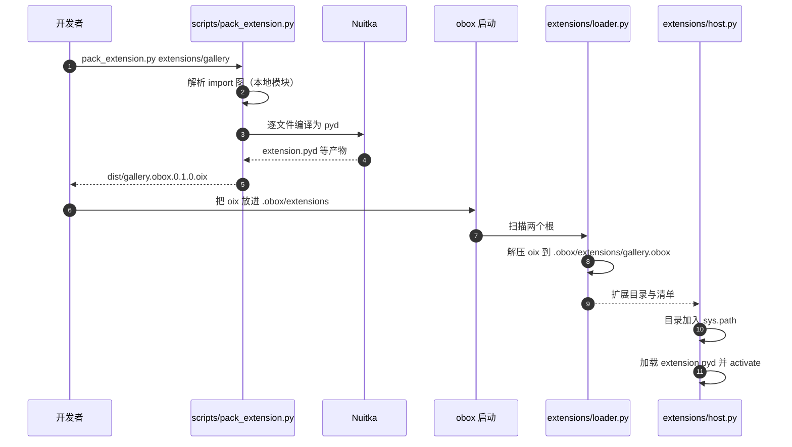
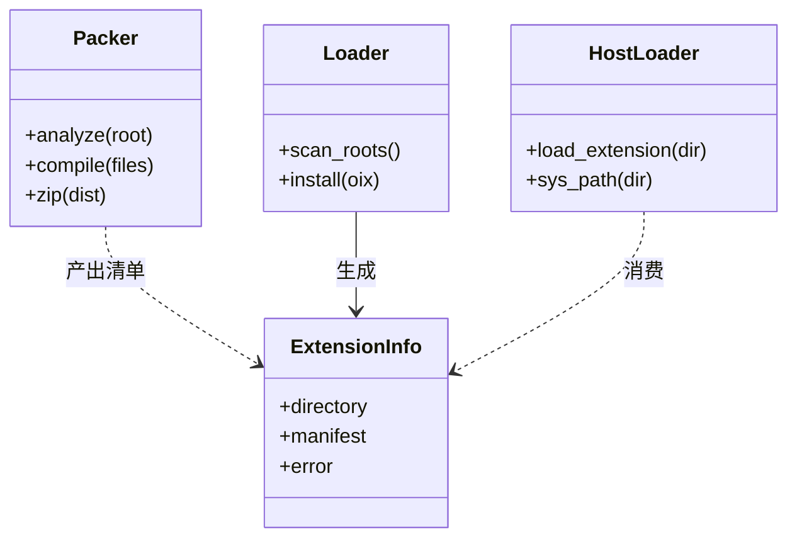

# 扩展打包 增量架构分析

## 变更背景

扩展目前只能以源码目录形式加载；本轮增加打包（源码→pyd→.oix）与安装（.oix→.obox/extensions/{id}）两条路径，加载侧增加 pyd 分支与模块搜索路径。

## 待修改模块

| 模块 | 现有职责 | 本次改动 | 影响面 |
|---|---|---|---|
| `scripts/pack_extension.py` | 不存在 | 新增：解析本地 import 图，逐文件 Nuitka 编译，zip 打包到 dist | 新增构建入口 |
| `obox/extensions/loader.py` | 扫描 extensions/ 目录 | 扫描双根；发现 .oix 解压安装；记录来源 | 扫描与安装 |
| `obox/extensions/manifest.py` | 校验 extension.json 与 extension.py 入口 | 入口允许 extension.py 或 extension.pyd | 校验规则 |
| `obox/extensions/host.py` | 从 extension.py 加载模块 | 优先 pyd；加载前把扩展目录加入 sys.path；记录重名告警 | 宿主加载分支 |
| `tests/` | 现有 129 例 | 新增 import 图、打包结构、安装、pyd 加载用例 | 断言 |

## 直接关联模块

| 模块 | 与待改模块的关系 | 本次是否要动 | 理由 |
|---|---|---|---|
| `obox/extensions/context.py` | 宿主注入给扩展的上下文 | 否 | 接口不变 |
| `docs/arch.md` | 项目级架构 | 收尾时动 | 补安装目录与打包产物 |
| `README.md` | 对外说明 | 收尾时动 | 补打包与安装用法 |

## 接口与依赖变化

| 接口 | 变化 | 消费方 |
|---|---|---|
| 扩展入口 | 允许 extension.pyd，优先于 extension.py | loader、host |
| 扫描根 | 增加 .obox/extensions | loader、app |
| 打包命令 | 新增 scripts/pack_extension.py，输出 dist/*.oix | 开发者 |

## 时序图（必需）

## UML 图（必需）

## 对整体架构的影响

- 分层与依赖方向不变：打包在工程脚本层，安装与加载仍在 extensions 子包内。
- 新增两个运行时目录：安装目录 .obox/extensions 与打包产物 dist/。
- 扩展分发形态从「源码目录」变为「.oix 包」，但加载契约（清单、activate/deactivate、context）不变。

## 风险与回滚

| 风险 | 触发条件 | 影响 | 应对 |
|---|---|---|---|
| 模块名跨扩展冲突 | 两个扩展都有同名本地模块 | 后加载者拿到别人的模块 | 记录告警；文档建议加前缀 |
| 编译耗时 | 每个 py 起一次 Nuitka | 打包慢 | 先解析可达文件再编译 |
| 路径穿越 | 恶意 zip 成员带 ../ | 写出安装目录 | 解压前校验成员路径 |
| 覆盖残留 | 新包文件更少 | 旧文件残留 | 覆盖前清空目标目录 |

回滚：删除打包脚本；加载退回仅 extension.py；扫描退回单根。
