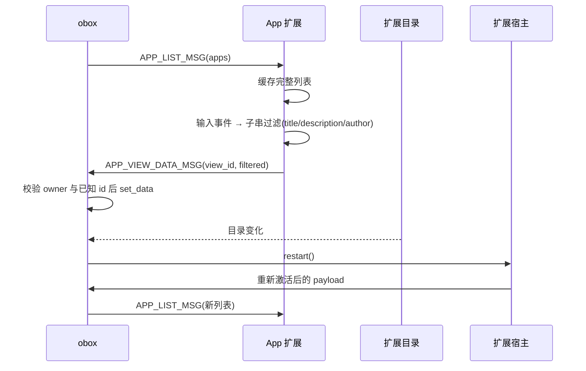
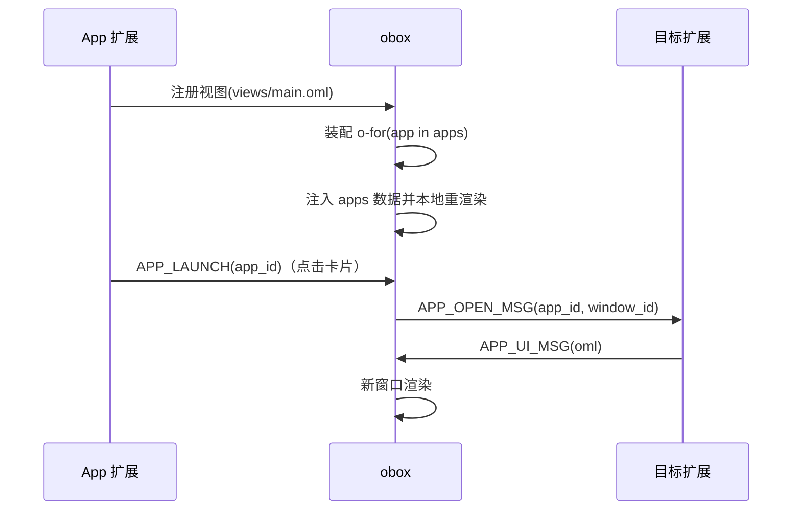
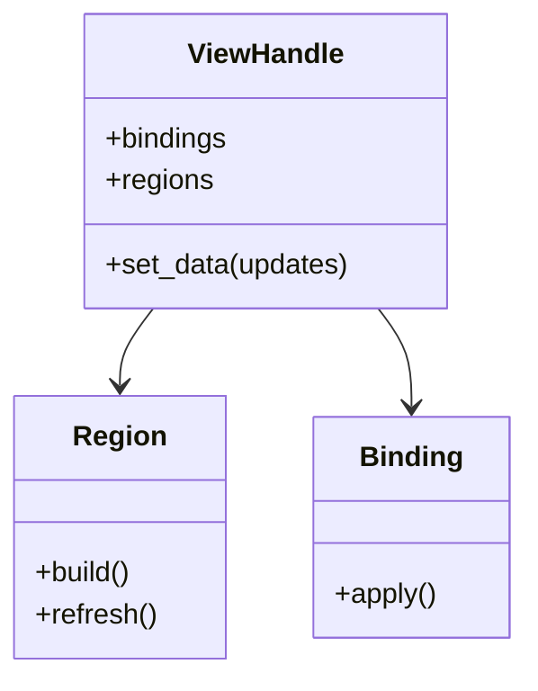

# App 扩展 增量架构分析

## 变更背景

扩展需要应用形态与数据驱动模板，清单新增 app 注册点，装配器需要指令与局部更新。

## 待修改模块

| 模块 | 现有职责 | 本次改动 | 影响面 |
|---|---|---|---|
| obox/ui/expr.py | 不存在 | 表达式求值：路径、length、字面量、比较、! | 模板层新增 |
| obox/ui/template.py | 不存在 | ViewHandle：数据、绑定、o-for/o-if 区域与局部更新 | 模板层新增 |
| obox/ui/builder.py | 解析片段并装配组件 | 接受作用域与数据，处理指令、绑定与区域 | 装配器改造 |
| obox/api/app.py | 开窗消息 | 新增 APP_LAUNCH_MSG | 契约层 |
| obox/api/lifecycle.py | 不存在 | mounted/updated/unmounted 消息 | 契约层 |
| obox/extensions/manifest.py | 校验清单 | contributes.app 支持数组与 icon/single/persistent | 清单契约 |
| obox/extensions/host.py | 激活扩展下发视图 | 结果带应用清单与图标绝对路径 | 宿主协议 |
| obox/app.py | 装配与消息 | 应用注册表、注入 apps 数据、APP_LAUNCH、开窗与持久化、生命周期 | 编排层 |
| extensions/app | 不存在 | 系统扩展：清单、视图、i18n | 新扩展 |

## 直接关联模块

| 模块 | 关系 | 是否要动 |
|---|---|---|
| obox/core/bus.py | 消息分发 | 否 |
| obox/ui/kit.py | 组件类型来源 | 否 |
| obox/extensions/context.py | 扩展侧 API | 否 |

## 应用搜索与扩展同步

| 模块 | 改动 |
|---|---|
| obox/api/app.py | APP_LIST_MSG（obox→App 扩展，推完整列表）、APP_VIEW_DATA_MSG（扩展→obox，回注过滤结果） |
| obox/app.py | 推送列表、校验回注来源、QFileSystemWatcher 监听扩展目录并去抖重启宿主 |
| obox/extensions/supervisor.py | 新增 restart() |
| extensions/app | 缓存列表、搜索框输入过滤、回注 |

## 时序图

## UML 图

## 对整体架构的影响

装配器新增模板层，窗口管理新增 AppWindow；分层与依赖方向不变。

## 回滚

删除 expr/template 与 AppWindow，清单忽略 contributes.app。

- 装配器从一次性构建变成可局部更新；组件 id 在区域重建时先注销再注册。
- 回滚：删除 template/expr，builder 退回无指令版本，应用页退回内建实现。