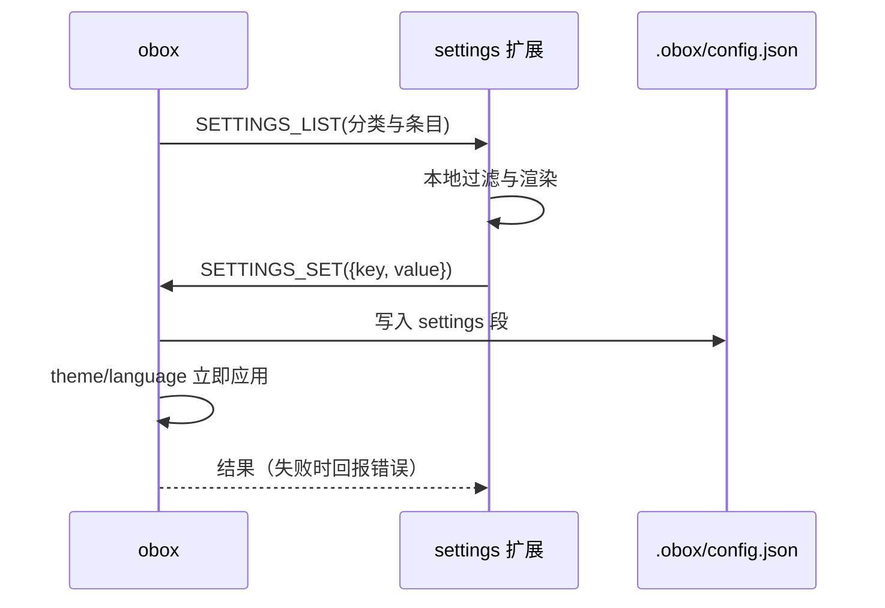
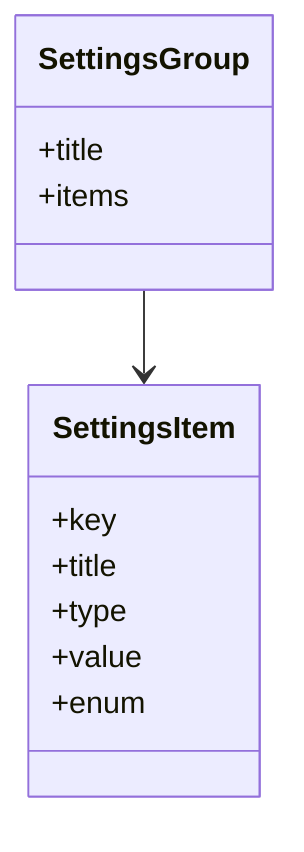

# 设置与侧栏容器 增量架构分析

## 变更背景

main 容器的语义不正确；设置页与扩展配置贡献需要新的数据通路。

## 待修改模块

| 模块 | 现有职责 | 本次改动 | 影响面 |
|---|---|---|---|
| obox/ui/main_window.py | rail + 视图栈，容器 main/bottom | 容器常量改为 sidebar/bottom | 主窗口 |
| obox/app.py | 挂载视图、消息处理 | 只认 sidebar/bottom；设置列表与写入 | 编排层 |
| obox/extensions/manifest.py | 清单校验 | 容器白名单；contributes.configuration | 清单契约 |
| obox/api/settings.py | 不存在 | SETTINGS_LIST / SETTINGS_SET | 契约层 |
| extensions/{app,demo,gallery} | container=main | 改为 sidebar | 三个扩展 |
| extensions/settings | 不存在 | 系统扩展：两栏设置页与搜索 | 新扩展 |

## 直接关联模块

| 模块 | 关系 | 是否要动 |
|---|---|---|
| obox/ui/template.py | 设置页的 o-for/o-if 与数据注入 | 否 |
| obox/i18n.py | 语言设置读取 | 否 |
| obox/extensions/supervisor.py | 宿主生命周期 | 否 |

## 时序图

## UML 图

## 对整体架构的影响

容器语义从 main 收敛为 sidebar；设置成为扩展而不是 obox 内建界面，配置读写仍由 obox 承担。

## 回滚

恢复 main 常量与清单容器，删除 settings 扩展与两条设置消息。
