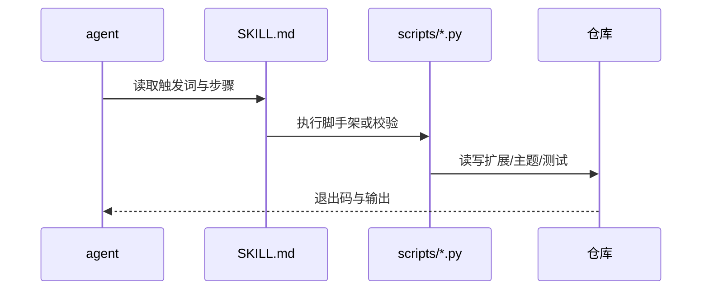
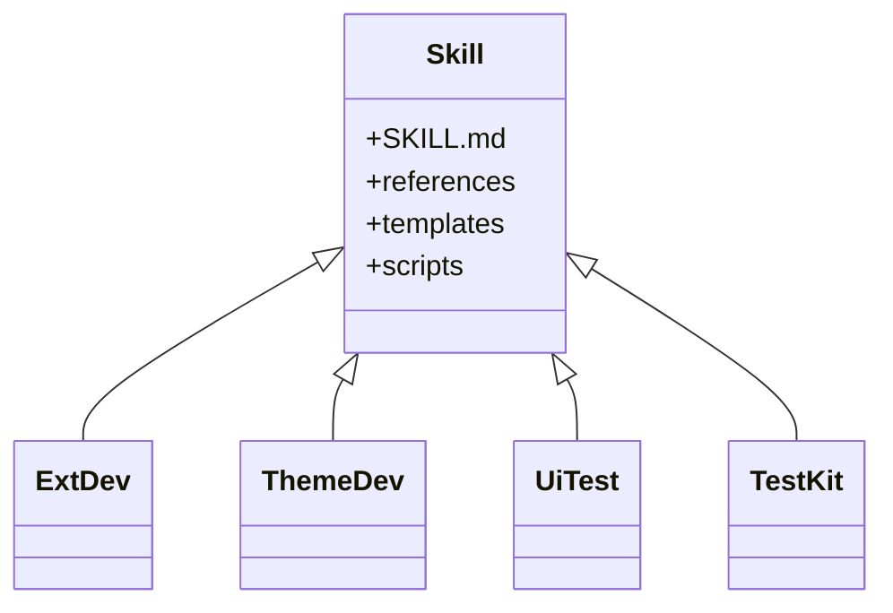

# obox 技能包 增量架构分析

## 变更背景

四类工作流已稳定，但知识分散；需要把它们沉淀为 agent 可直接调用的技能与脚本。

## 待修改模块

| 路径 | 本次改动 | 影响面 |
|---|---|---|
| .agents/skills/obox-ext-dev | 新增技能：清单/context/oml/i18n/打包 + 脚手架与校验 | 扩展作者 |
| .agents/skills/obox-theme-dev | 新增技能：组件契约/主题常量/构建 + 契约校验 | 主题作者 |
| .agents/skills/obox-ui-test | 新增技能：driver/verify/截图 + 一键脚本 | 验收 |
| .agents/skills/obox-test | 新增技能：测试矩阵/门禁 + 汇总脚本 | 测试 |

## 直接关联模块

| 模块 | 关系 | 是否要动 |
|---|---|---|
| scripts/verify_ui.py、scripts/ui_driver.py | 被 ui-test 技能调用 | 否 |
| scripts/build_theme.py、scripts/pack_extension.py | 被主题/扩展技能引用 | 否 |
| obox/extensions/manifest.py | 校验脚本复用 load_manifest | 否 |
| obox/ui/component_protocol.py | 契约校验复用 REQUIRED_TAGS 与 validate | 否 |

## 时序图

## UML 图

## 对整体架构的影响

只新增文档与工具，不改运行时与消息契约；技能通过脚本间接使用现有模块。

## 回滚

删除 .agents/skills 下四个目录与 README 对应小节。
