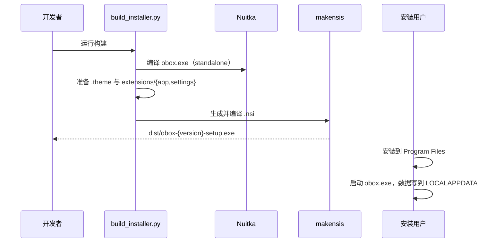
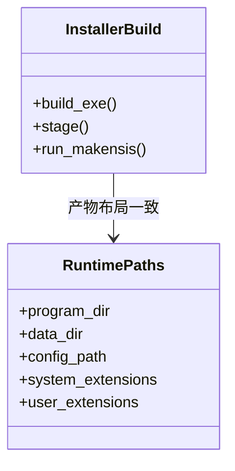

# 安装包 增量架构分析

## 变更背景

需要可分发的 Windows 安装包；程序目录只读、数据目录可写，并随装两个系统扩展。

## 待修改模块

| 模块 | 现有职责 | 本次改动 |
|---|---|---|
| obox/runtime.py | 不存在 | 程序目录与数据目录解析（安装态/源码态） |
| obox/app.py | 组装、配置读写、主题加载 | 用 runtime 解析替换硬编码 project_root/.obox |
| obox/extensions/supervisor.py | 启动宿主并传路径 | 传数据目录与三个扩展根 |
| obox/extensions/host.py | 扫描与激活扩展 | 接收系统扩展根 |
| obox/extensions/loader.py | 两根扫描 | 三根扫描与优先级 |
| scripts/build_exe.py、build_installer.py、installer/obox.nsi | 不存在 | 构建 exe 与安装包 |

## 直接关联模块

| 模块 | 关系 | 是否要动 |
|---|---|---|
| scripts/build_theme.py | 安装包依赖 .theme 产物 | 否（由构建脚本调用） |
| obox/ui/kit.py | 从 .theme 加载套件 | 否 |
| .agents/skills/obox-ext-dev | 打包与安装说明 | 是（AGENTS.md 同步规则） |

## 时序图

## UML 图

## 对整体架构的影响

部署形态从「源码运行」扩展为「安装运行」；运行期多一层路径解析，扩展扫描多一个系统根。分层与消息契约不变。

## 回滚

删除 runtime.py 与构建脚本，project_root 恢复源码推导，扫描退回两根。
