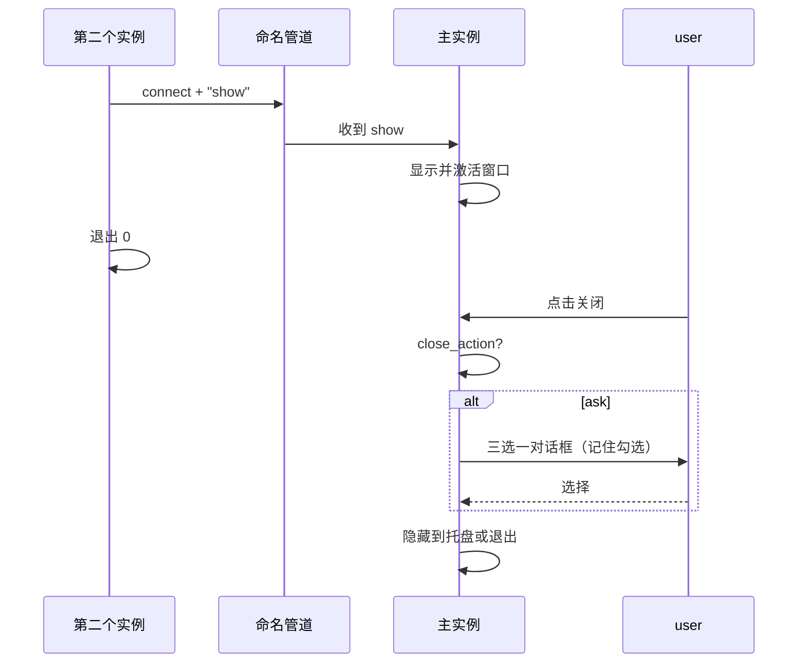
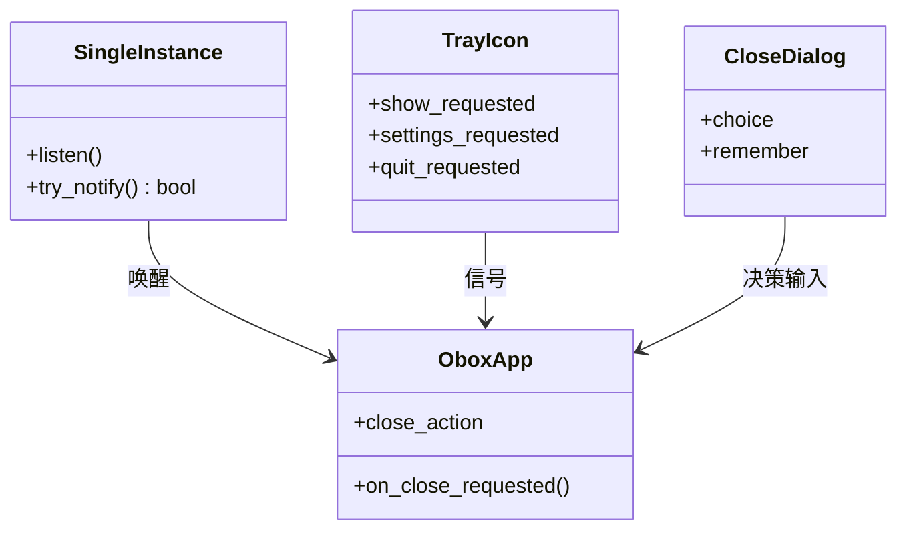

# 托盘与单实例 增量架构分析

## 变更背景

需要单实例、托盘常驻与可配置的关闭行为；改动集中在 obox/ui 与 app 启动/关闭流程。

## 待修改模块

| 模块 | 改动 |
|---|---|
| obox/app.py | 启动前探测实例；创建托盘；关闭信号接决策 |
| obox/ui/main_window.py | closeEvent 改为发 close_requested 信号 |
| obox/ui/single_instance.py | 新增：管道探测/监听/唤醒 |
| obox/ui/tray.py | 新增：托盘图标与菜单 |
| obox/ui/close_dialog.py | 新增：三选一对话框 |

## 直接关联模块

| 模块 | 关系 | 是否要动 |
|---|---|---|
| 设置服务（app._settings_groups/_on_settings_set） | close_action 项 | 是 |
| 主题套件常量 | 对话框取色与圆角 | 否 |
| 扩展宿主 | 无 | 否 |

## 时序图

## UML 图

## 对整体架构的影响

新增三个 UI 辅助模块；启动路径多一步实例探测；关闭路径由窗口自行退出改为 app 决策。消息契约与扩展加载不变。

## 回滚

删除三个模块与相关调用，closeEvent 恢复直接退出，设置项移除。
