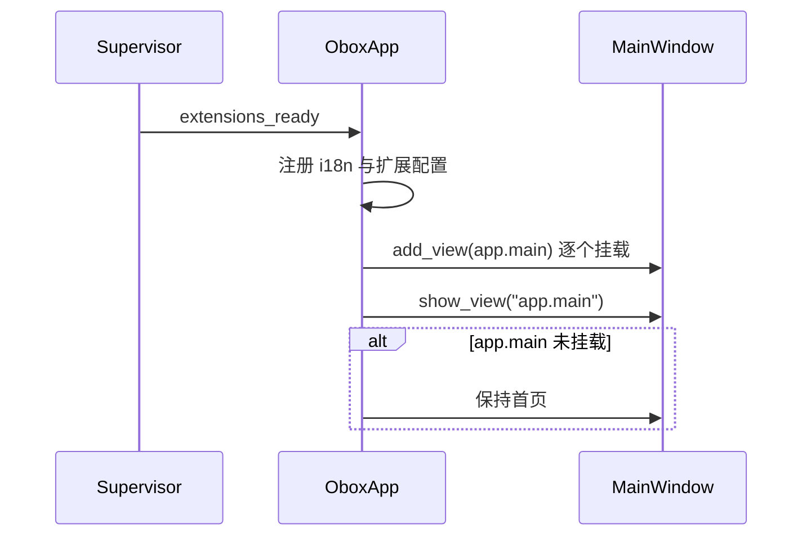
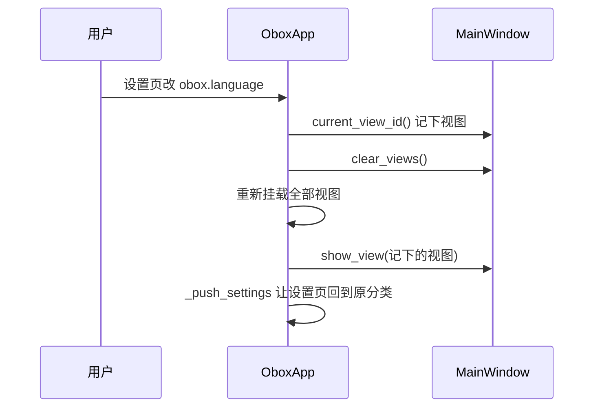
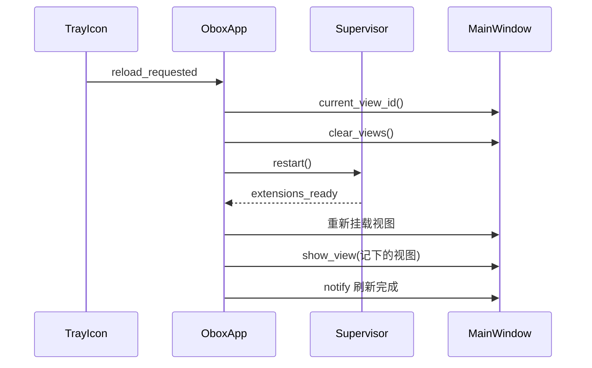
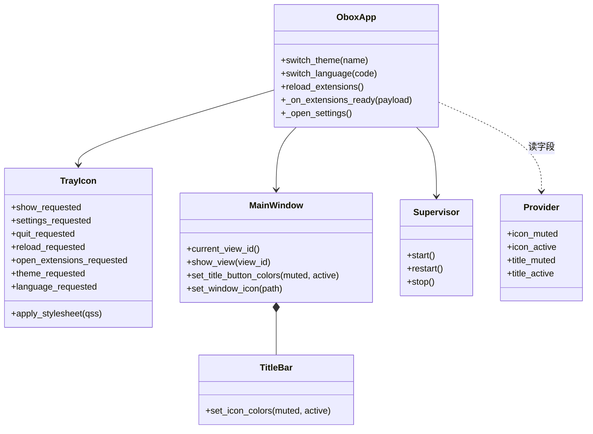

# 界面细节与启动体验 增量架构分析

## 变更背景

本次动外壳与主题两层：外壳侧启动后要落到 App 应用页、切语言/主题后回到原位、任务栏与托盘有图标与分组菜单；主题侧调滑块轨道与标题栏按钮对比度；设置扩展补一种只读条目类型。需求口径见 delta-spec.md，设计清单见 delta-design.md。

## 待修改模块

| 模块 | 现有职责 | 本次改动 | 影响面 |
|---|---|---|---|
| `obox/app.py` | 应用装配：启动、切换主题/语言、设置贡献、托盘接线 | 版本项改 type=label；启动 show_view 应用页；两处切换记位恢复；托盘四个新信号接线；新增 reload_extensions；run() 设 AppUserModelID 与应用图标 | 最大的单点改动，无新增模块 |
| `obox/ui/tray.py` | 托盘图标与三项 QMenu | 三组菜单、主题/语言可勾选子菜单、四个新信号、外部样式注入 | 信号面扩大，调用方仅 app.py |
| `obox/ui/main_window.py` | 主窗口壳、侧栏与栈 | 新增 current_view_id()；标题栏按钮配色；应用窗口共用图标 | 壳 API 增加一个只读方法 |
| `obox/ui/title_bar.py` | 自绘标题栏与窗口按钮 | 按钮颜色由外部注入，默认值改深色 | 不改绘制逻辑 |
| `obox/ui/app_window.py` | 应用独立窗口 | 窗口图标改用 obox 图标 | 单行 |
| `theme/light/theme.py`、`theme/dark/theme.py` | 调色板与 QSS | 新增 TITLE_MUTED / TITLE_ACTIVE；滑块轨道换色；新增 #obox-tray-menu 及条目 QSS | 只增选择器 |
| `theme/light/provider.py`、`theme/dark/provider.py` | 套件对 obox 暴露的提供者 | 暴露 title_muted / title_active | 契约字段增加，旧消费方用 getattr 兜底 |
| `extensions/settings/views/main.oml` | 设置页片段 | 条目渲染增加 label 分支 | 只增一条 o-if |
| `scripts/build_exe.py` + `obox/assets/obox.ico` | 编译 standalone exe | 生成 ico 并传 --windows-icon-from-ico | 新增一个资源文件 |
| `scripts/verify_ui.py` | 界面验证 | 新场景：启动落点、切换保位、版本号只读、托盘结构、滑块与标题栏截图 | 场景与截图编号变化 |
| `tests/test_tray.py`、`tests/test_app_switches.py`、`tests/test_settings_label.py` | 新增测试 | 覆盖菜单结构、切换保位、label 渲染 | 新文件 |

## 直接关联模块

| 模块 | 与待改模块的关系 | 本次是否要动 | 理由 |
|---|---|---|---|
| `obox/extensions/supervisor.py` | 提供 restart()，刷新扩展直接调用 | 否 | stop + start 已足够，签名不变 |
| `extensions/settings/extension.py` | 持有设置页分类状态，重建后继续推数据 | 否 | 状态活在宿主进程，重建只换视图控件 |
| `obox/ui/component_protocol.py` | 校验 provider 字段 | 否 | title_* 为可选字段，不强制 |
| `scripts/build_installer.py`、`installer/*.nsi` | 打包 exe 与安装包 | 否 | 沿用 build/obox.dist/obox.exe，图标随 exe 走 |

## 接口与依赖变化

- 托盘新增信号：`reload_requested`、`open_extensions_requested`、`theme_requested(str)`、`language_requested(str)` 与 `stylesheet_changed` 不再需要——样式由 `apply_stylesheet(qss)` 注入。旧三项信号保留，删除属于破坏性变化，本次保留兼容。
- `MainWindow.current_view_id() -> str`：返回当前栈中视图 id，首页返回空串；`show_view(view_id)` 已存在，复用。
- `MainWindow.set_title_button_colors(muted, active)`：把标题栏按钮配色与侧栏图标配色解耦。
- provider 可选字段 `title_muted` / `title_active`：缺失时回退 `icon_muted` / `icon_active`。
- 设置项类型集合在宿主侧增加 `label`；扩展配置贡献的类型集合不变。
- 新增资源 `obox/assets/obox.ico`，由 `obox.svg` 生成，供 exe 与安装包使用。
- 依赖方向不变：外壳不 import 主题包，仍经 provider 字段取值。

## 时序图（必需）

启动落点：

切语言保位：

托盘刷新扩展：

## UML 图（必需）

## 对整体架构的影响

无结构性影响：不新增模块、包或进程，依赖方向不变（外壳只经 provider 字段读主题值），部署形态不变。两处形态变化：设置项的渲染类型集合多一个 label（宿主侧），托盘对象从三项菜单扩成带子菜单的菜单树并多四个信号；两者都留在原分层内。

## 风险与回滚

| 风险 | 连带影响 |
|---|---|
| 重建期间托盘可点，reload 与 switch 重入 | reload 设运行中标记，重入直接返回；重建完成后清标记 |
| app.main 被扩展改名导致启动落点失效 | 常量集中一处，找不到时退回首页并打日志 |
| QMenu 透明圆角在部分 Windows 失效 | 退化为直角菜单，功能与分组不变 |
| AppUserModelID 晚于 QApplication 设置无效 | run() 首行设置，测试断言调用序 |
| exe 图标生成失败 | 编译脚本回退为无图标并在日志说明，不阻断构建 |

回滚：托盘回退 tray.py 与 #obox-tray-menu 段；启动落点回退 show_view 一行；保位回退两处记位；label 回退 app.py 类型与 main.oml 分支；颜色回退 theme.py 常量与 provider 字段；ico 回退为不传参数。
