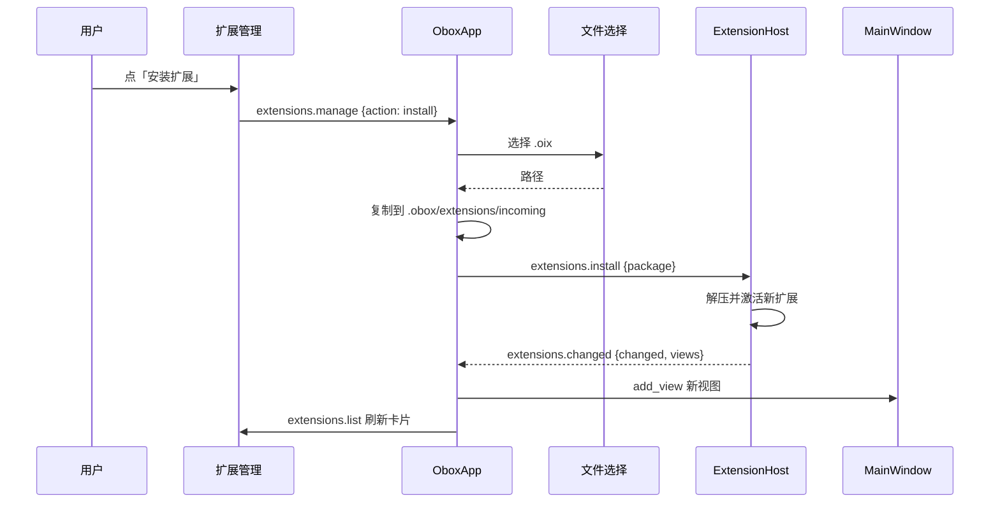
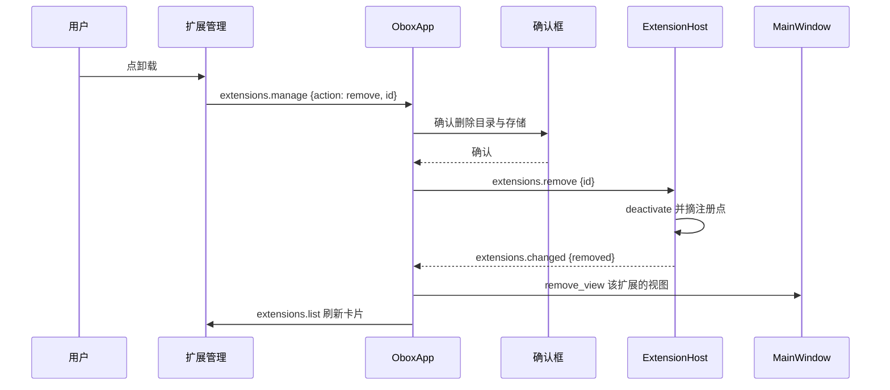
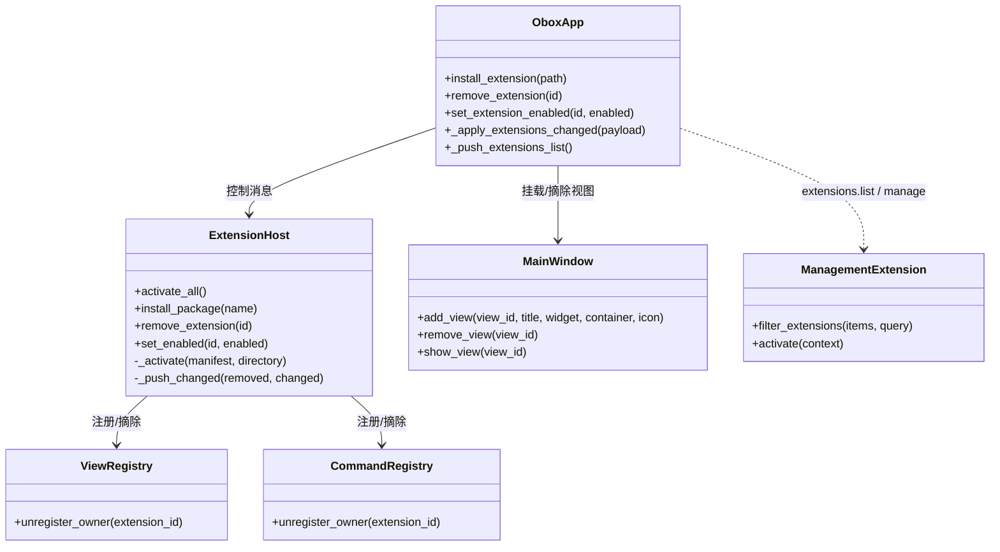

# 扩展管理 增量架构分析

## 变更背景

本次把扩展的安装、卸载与启用停用从「仅启动时」扩展到「运行中由消息驱动」：新增系统扩展承载页面，obox 负责编排与确认，扩展宿主负责解压、加载与摘除，双方新增一组控制消息与一条变更回推。需求口径见 delta-spec.md，设计清单见 delta-design.md。

## 待修改模块

| 模块 | 现有职责 | 本次改动 | 影响面 |
|---|---|---|---|
| `obox/api/extensions.py`（新） | 无 | 定义安装、卸载、启用/停用三条控制消息与「扩展变更」回推、管理页列表消息 | 新增模块，消息契约的新边界 |
| `obox/extensions/host.py` | 启动时激活全部扩展，推一次状态 | 监听控制消息；运行中安装/卸载/启停；每次动作后回推变更（removed 与 changed） | 宿主生命周期从一次性变为可增删 |
| `obox/extensions/loader.py` | 扫描根目录、启动时安装 .oix | 增加单包安装与卸载；扫描忽略 incoming 子目录 | 函数级新增，扫描语义不变 |
| `obox/app.py` | 收到 status 后整批挂视图 | 编排安装对话框与确认框；复制包到 incoming；转发控制消息；按扩展 id 差量挂/摘视图；写禁用名单 | 从一次性挂载变为可增删，需处理当前视图被摘的情况 |
| `obox/ui/main_window.py` | add_view / clear_views | 新增 remove_view(view_id) | 单方法 |
| `obox/ui/confirm_dialog.py`（新） | 无 | 卸载确认框，显示扩展 id 与将被删除的目录 | 新增文件，沿用浮层面板样式 |
| `extensions/management/`（新） | 无 | 系统扩展：清单、入口、页面、i18n、图标 | 新增第三个系统扩展与侧栏入口 |
| `tests/test_extension_manage.py`（新） | 无 | 消息流转、差量应用、禁用名单、过滤函数 | 新增测试 |
| `.agents/skills/obox-ext-dev` | 扩展 API 与清单文档 | 补控制消息与扩展管理页的编写方式 | 文档 |

## 直接关联模块

| 模块 | 与待改模块的关系 | 本次是否要动 | 理由 |
|---|---|---|---|
| `obox/extensions/contributions.py` | 提供 ViewRegistry 与 CommandRegistry 的 `unregister_owner` | 否 | 卸载时直接复用，接口够用 |
| `obox/extensions/context.py` | 扩展拿到的注册与消息能力 | 否 | 管理扩展用现有 send/on 即可，不加新能力 |
| `obox/extensions/manifest.py` | 清单解析与校验 | 否 | 不需要新字段 |
| `obox/core/bus.py` | 进程内与跨进程消息路由 | 否 | 控制消息复用现有总线与信封 |

## 接口与依赖变化

- 新增消息：`extensions.install`（payload 带包文件名）、`extensions.remove`（扩展 id）、`extensions.enable`（扩展 id 与 enabled）、`extensions.changed`（宿主回推：removed、changed、views、commands），以及 obox 推给管理扩展的 `extensions.list`。
- 宿主内部状态从「装完即定」变为可增删：`_modules`、`_contexts`、`_manifests`、`_i18n` 要能按 id 增删，注册表按 owner 摘除。
- `MainWindow.remove_view(view_id)` 新增；`add_view` 与 `show_view` 不变。
- 配置新增 `.obox/config.json` 的 `extensions.disabled` 数组；宿主启动时读取，obox 写入。
- 依赖方向不变：管理扩展与其它扩展一样只经 context 与 obox 通信；obox 仍不 import 宿主内部实现，只发消息。

## 时序图（必需）

运行中安装：

卸载或禁用：

## UML 图（必需）

## 对整体架构的影响

无结构性影响：不新增进程、不新增包，宿主仍是唯一持有扩展生命周期的地方，obox 仍是唯一 UI 宿主；依赖方向不变。协议层面新增了一类「obox 发往宿主的控制消息」，此前只有组件事件、状态查询与修改、设置写入三类，属于协议扩展而非架构重排。系统扩展从两个变三个，侧栏入口多一个。

## 风险与回滚

| 风险 | 连带影响 |
|---|---|
| 卸载正在显示的扩展视图 | 摘除前先切到扩展管理页，再 remove_view |
| 重装同 id 命中旧模块缓存 | 以新目录路径加载并换模块名；失败记日志，不承诺模块级回收 |
| 宿主回推与 obox 的 id 对不齐 | 以扩展 id 为粒度整体摘除，不按视图 id 逐个对 |
| incoming 残留包 | 启动扫描忽略该目录，每次安装前清空 |
| 停用被误用到系统扩展 | 宿主按来源拒绝，管理页不渲染按钮，两层兜底 |

回滚：控制消息与宿主处理可整体回退，管理页目录独立可删；禁用名单是 config 里的数组，清空即恢复；卸载只动 .obox/extensions 与扩展存储，不碰源码与内置目录。
