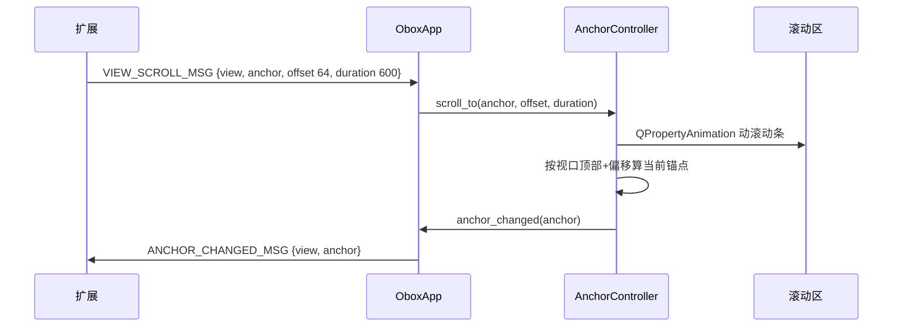
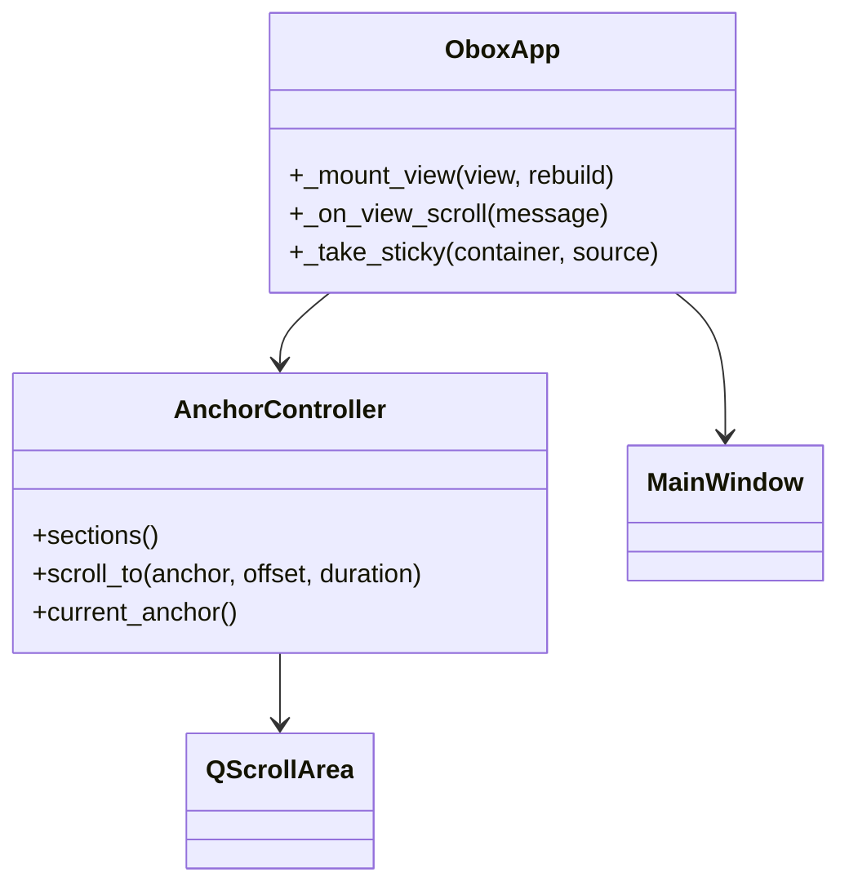

# 视图锚点 增量架构分析

## 变更背景

给扩展视图补一条通用的滚动锚点能力：扩展要求滚到某个组件，obox 平滑滚动并在滚动时回推当前锚点；视图可以把一个直接子组件声明为吸顶条。需求口径见 delta-spec.md。

## 待修改模块

| 模块 | 现有职责 | 本次改动 | 影响面 |
|---|---|---|---|
| `obox/api/view.py` | 视图数据回注 | 新增滚动与锚点两条消息 | 新增消息，不影响 VIEW_DATA_MSG |
| `obox/ui/anchor.py`（新） | 无 | 滚动控制器：目标计算、动画、锚点归属 | 新文件，只被 app 使用 |
| `obox/app.py` | 视图装配与消息路由 | sticky 抬出、挂控制器、订阅滚动、回推锚点 | 装配多一步，路由多两条 |
| `tests/test_anchor.py`（新） | 无 | 上述行为测试 | 新增测试 |
| `.agents/skills/obox-ext-dev` | 扩展文档 | 补 sticky 与两条消息 | 文档 |

## 直接关联模块

| 模块 | 与待改模块的关系 | 本次是否要动 | 理由 |
|---|---|---|---|
| `obox/ui/builder.py` | 片段装配 | 否 | _mount_view 再解析一次片段定位 sticky 索引 |
| `obox/ui/parser.py` | 片段解析 | 否 | 复用 parse_fragment |
| `obox/ui/registry.py` | 组件查找 | 否 | 取视图根组件控件用 lookup，接口不变 |
| `obox/ui/main_window.py` | 视图容器 | 否 | 滚动区仍由 _mount_view 创建 |

## 接口与依赖变化

- 新增 `VIEW_SCROLL_MSG`（扩展 → obox：view_id、anchor、offset、duration）与 `ANCHOR_CHANGED_MSG`（obox → 扩展：view_id、anchor）。
- 视图片段新增 sticky 属性：视图根的直接子组件生效，只取第一个。
- 依赖方向不变，组件标签数不变。

## 时序图（必需）

## UML 图（必需）

## 对整体架构的影响

无结构性影响：不新增进程与包，扩展与 obox 的边界仍是一组消息；外壳多一个滚动控制器与两条消息。设置页未改动。

## 风险与回滚

| 风险 | 连带影响 |
|---|---|
| 内容高度变化导致目标值过期 | 每次滚动按当前几何重算 |
| sticky 取出后留白 | 从原布局移除，不占位 |
| 滚动事件频繁 | 只在锚点变化时回推 |

回滚：删 anchor.py 与两条消息，_mount_view 不处理 sticky 即可，其它模块不受影响。
