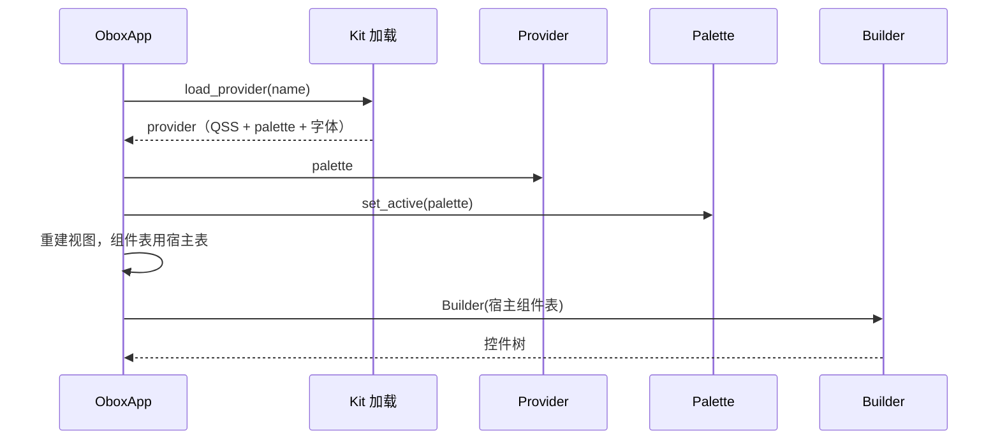
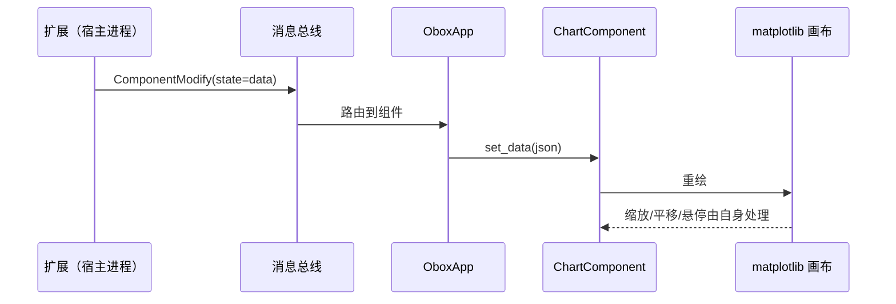
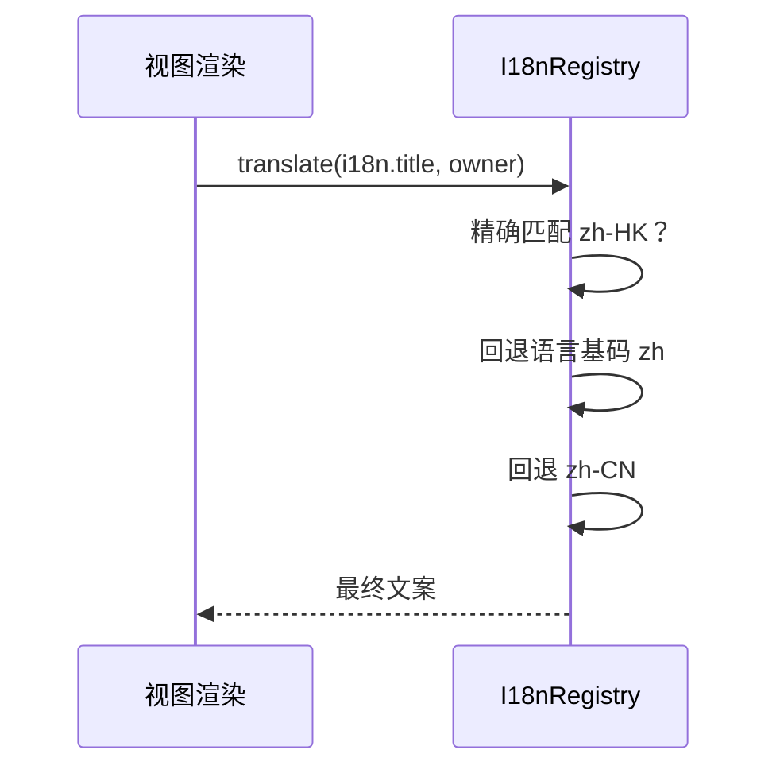
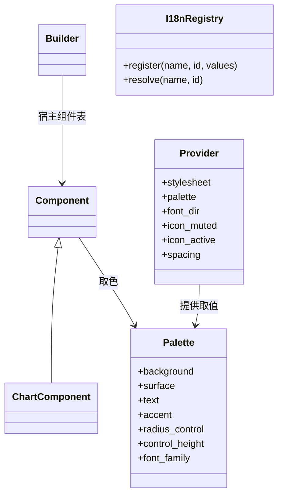

# 组件归位与区域语言 增量架构分析

## 变更背景

本次动的是组件归属与语言体系：21 个组件从主题包迁到 obox，主题退化为样式包（QSS + 调色板 + 字体）；新增 matplotlib 图表组件；i18n 支持地区与基码回退。需求口径见 delta-spec.md，设计清单见 delta-design.md。

## 待修改模块

| 模块 | 现有职责 | 本次改动 | 影响面 |
|---|---|---|---|
| `obox/ui/palette.py`（新） | 无 | 调色板结构与全局活动调色板，供组件取色 | 新增模块，被全部组件依赖 |
| `obox/ui/components/`（新） | 无 | 从主题迁入的 21 个组件，单份实现，颜色走 palette | 组件实现整体搬家 |
| `obox/ui/components/chart.py`（新） | 无 | matplotlib QtAgg 画布与交互 | 引入 matplotlib |
| `obox/ui/components/__init__.py`（新） | 无 | 宿主组件表（21 + chart） | 组件表的新归属 |
| `obox/ui/component_protocol.py` | 校验 provider 的组件表 | REQUIRED_TAGS 改为宿主校验；provider 只校验样式能力 | 契约语义改变 |
| `obox/ui/builder.py` | 从 provider.component_types 取组件类 | 改为宿主组件表（app 注入） | 装配入口换数据源 |
| `obox/ui/kit.py` | 加载套件并校验 | 校验新字段（palette），不再要求组件表 | 校验流程变化 |
| `obox/app.py` | 应用主题、装配视图、下发设置 | 设置活动调色板；用宿主组件表装配；语言项全量地区 | 装配与设置两处变化 |
| `theme/light/theme.py`、`dark/theme.py` | 颜色常量与 QSS | 导出 PALETTE 字典，删除 components 目录 | 主题包瘦身 |
| `theme/light/provider.py`、`dark/provider.py` | 暴露组件表、样式、字体、图标色 | 去掉组件表，增加 palette | 契约实现变化 |
| `theme/_build/light.py`、`dark.py` | 打包主题（含组件） | 只打包样式、调色板与字体 | 构建产物变化 |
| `obox/i18n.py` | 精确匹配 + zh-CN 兜底 | 精确 → 语言基码 → zh-CN；注册强制 zh-CN | 文案解析路径变化 |
| `pyproject.toml` | 依赖 PySide6 | 加 matplotlib | 安装体积增加 |
| `tests/` 与技能文档 | 按主题组件表测试 | 改宿主组件表与调色板；新增 chart、i18n 回退用例 | 测试与文档大改 |

## 直接关联模块

| 模块 | 与待改模块的关系 | 本次是否要动 | 理由 |
|---|---|---|---|
| `obox/ui/registry.py` | 组件实例的登记与查找 | 否 | 组件来源变化不影响注册表 |
| `obox/ui/template.py` | 绑定与区域更新 | 否 | 只按组件接口调用 |
| `extensions/settings` | 渲染设置项 | 否 | 语言项由 app 下发，扩展只按类型渲染 |
| `obox/extensions/host.py`、`loader.py` | 加载扩展与 i18n 文件 | 否 | i18n 校验走同一注册表，注册失败由注册表抛错 |

## 接口与依赖变化

- provider 契约：去掉 `component_types`；新增 `palette`（颜色、圆角、控件高度、字体族）；样式相关字段（stylesheet、font_dir、icon 两色、title 两色、danger、spacing）保留。
- 宿主组件表 `obox.ui.components.COMPONENT_TYPES`：21 个既有标签 + chart；REQUIRED_TAGS 的校验对象从 provider 改为这张表。
- `Builder` 构造参数不变，传入的 component_types 改为宿主表。
- chart 的状态：data（JSON 字典或字符串）与 title；事件：click（点数据点）。
- i18n 解析：精确 → 语言基码（zh-*、en-*）→ zh-CN；注册缺 zh-CN 直接拒绝。
- 依赖方向变化：obox 的组件不再来自主题，主题包不再包含任何组件代码；obox 对 theme 的依赖收敛为一个调色板字典与一段 QSS。

## 时序图（必需）

切换主题并重建视图：

图表数据跨进程：

语言解析：

## UML 图（必需）

## 对整体架构的影响

结构性变更，但不新增进程与包：组件归属从主题迁到宿主，分层内的依赖方向改变——obox 的 UI 组件不再由主题注入，主题从「组件 + 样式」降级为「样式 + 调色板」，构建产物随之变小。部署形态不变，扩展仍经消息与 obox 交互；新增 matplotlib 作为运行时依赖。

## 风险与回滚

| 风险 | 连带影响 |
|---|---|
| 21 个组件迁移引入行为差异 | 逐组件对照旧实现，用组件测试与两套 verify 截图回归 |
| 全局调色板时序（组件早于主题创建） | app 在装配前设置；palette() 未设置时返回亮色默认并记一次日志 |
| 主题 pyd 残留组件模块 | 构建脚本只吃 styles 与 palette；重编后检查产物 |
| matplotlib 体积与打包 | 运行时依赖 + 打包包含数据；缺失时 chart 显示未安装提示 |
| 全量地区列表过长 | Select 支持搜索；原生名重复时补地区代码 |
| 回退链改变既有文案 | 单测覆盖 zh-HK、en-GB、zh-TW、未知语言 |

回滚：恢复主题的 components 与 provider.component_types，装配器改回从 provider 取；palette 模块保留但不再使用；chart 与 i18n 改动可独立回退。
