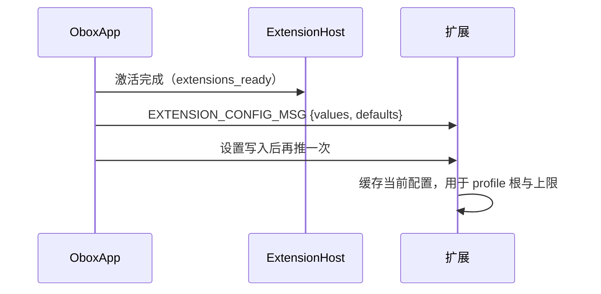
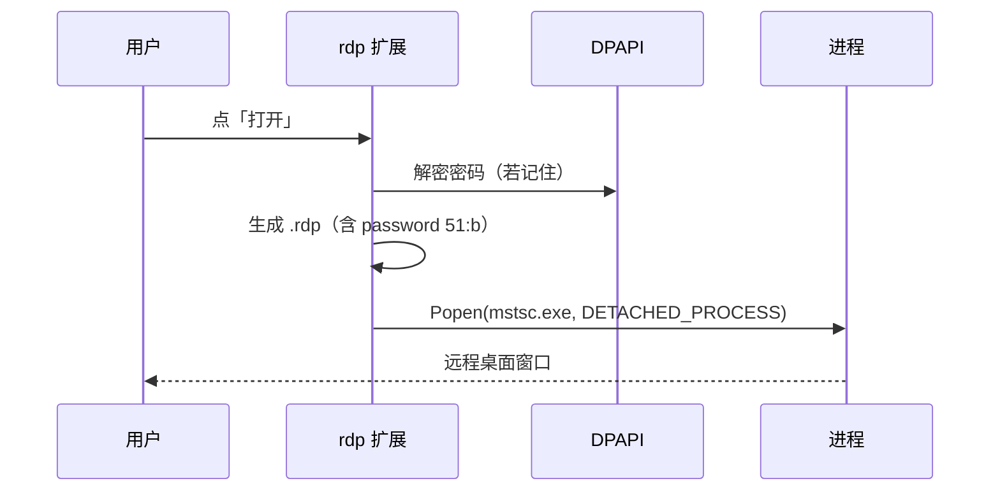
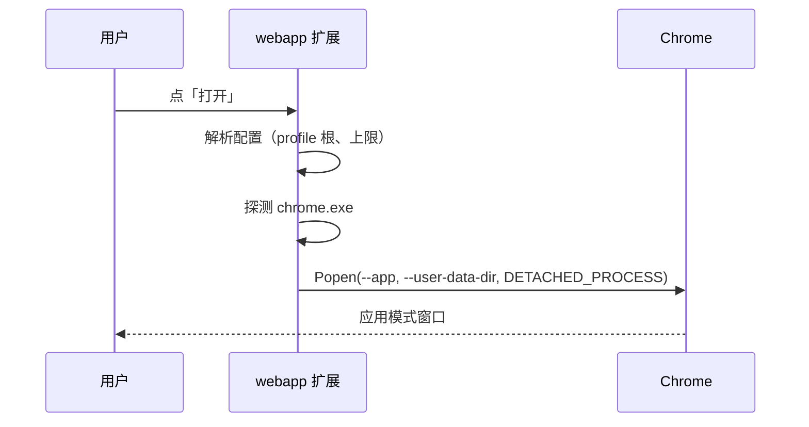
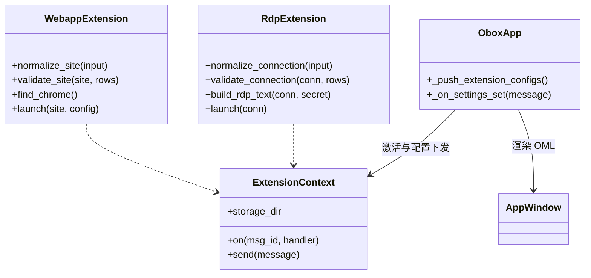

# 远程桌面与网页应用 增量架构分析

## 变更背景

新增两个用户扩展（rdp、webapp）与一条「扩展读取自己配置」的下发通道：两个扩展以 App 卡片出现，界面用 OML 在 AppWindow 渲染，系统能力（DPAPI、mstsc、Chrome）在扩展进程内调用。需求口径见 delta-spec.md。

## 待修改模块

| 模块 | 现有职责 | 本次改动 | 影响面 |
|---|---|---|---|
| `obox/api/settings.py` | 设置列表与写入消息 | 新增 EXTENSION_CONFIG_MSG（obox → 扩展，带 values 与 defaults） | 新增消息类型 |
| `obox/app.py` | 汇总设置项、推送设置页 | 激活后与设置变更后把扩展配置发给扩展 | 消息路由多一条发送点 |
| `extensions/rdp/`（新） | 无 | App 卡片、连接 CRUD、DPAPI、.rdp、mstsc 脱离启动 | 新扩展目录 |
| `extensions/webapp/`（新） | 无 | App 卡片、站点 CRUD、配置读取、Chrome 探测与启动 | 新扩展目录 |
| `tests/test_extensions_process.py`（新） | 无 | 校验、.rdp 文本、命令拼装、Chrome 探测 | 新测试 |
| `tests/test_extension_config.py`（新） | 无 | 配置下发时机与过滤 | 新测试 |
| `scripts/verify_ui.py` | 界面验证 | 打开两个 App 并截图 | 场景与编号 |
| `.agents/skills/obox-ext-dev` | 扩展开发文档 | 补 App 卡片与配置读取示例 | 文档 |

## 直接关联模块

| 模块 | 与待改模块的关系 | 本次是否要动 | 理由 |
|---|---|---|---|
| `obox/extensions/context.py` | 扩展拿到的能力 | 否 | 扩展用现有 on/send 订阅配置消息 |
| `obox/extensions/host.py` | 激活扩展并转发消息 | 否 | 配置消息由 obox 直接发给扩展，宿主只转发 |
| `obox/ui/app_window.py` | 渲染 App 的 OML | 否 | 两个扩展复用现有 AppWindow |
| `obox/extensions/manifest.py` | 解析 contributes | 否 | app 与 configuration 字段已支持 |

## 接口与依赖变化

- App 窗口装配保留 ViewHandle，`app. 加窗口 id` 走 VIEW_DATA_MSG 注入；扩展目录按 extensions 清单登记，供 App 页面加载 OML。
- 新增 `EXTENSION_CONFIG_MSG`：payload `{values: {key: value}, defaults: {key: value}}`，只含该扩展前缀的键；obox 在扩展激活后与设置写入后各发一次。
- rdp 存储：`storage_dir/connections.json`、`storage_dir/secrets.json`（DPAPI 密文 base64）；打开时写临时 .rdp 到 `storage_dir/tmp`。
- webapp 存储：`storage_dir/sites.json`；profile 默认在 storage_dir/profiles 下按条目 id 分目录，可由配置改根。
- 两个扩展都只依赖标准库与 `obox.api.*`；Windows 能力用 ctypes/winreg/subprocess，无第三方依赖。
- 依赖方向不变：扩展不 import obox 内部实现，只经消息与 obox 交互。

## 时序图（必需）

配置下发：

RDP 打开：

Webapp 打开：

## UML 图（必需）

## 对整体架构的影响

无结构性影响：不新增进程类型、不改宿主与 obox 的通道；只是多一条消息与两个扩展目录。系统能力仍封在扩展内，宿主不感知 mstsc/Chrome。

## 风险与回滚

| 风险 | 连带影响 |
|---|---|
| 配置消息早于扩展订阅 | obox 在激活后发送，扩展用最后一条为准 |
| DPAPI 在受限环境失败 | 降级为不记住密码，页面提示 |
| 密码文件被同用户进程读取 | DPAPI 同用户可解，文件权限限当前用户 |
| Chrome 路径探测不到 | 页面提示，不启动进程 |

回滚：删掉两个扩展目录与配置消息即可，其它模块不受影响。