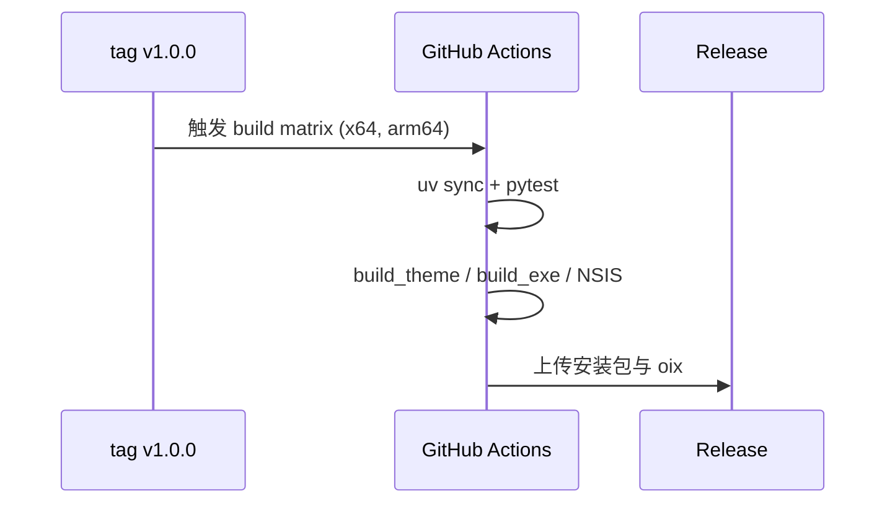
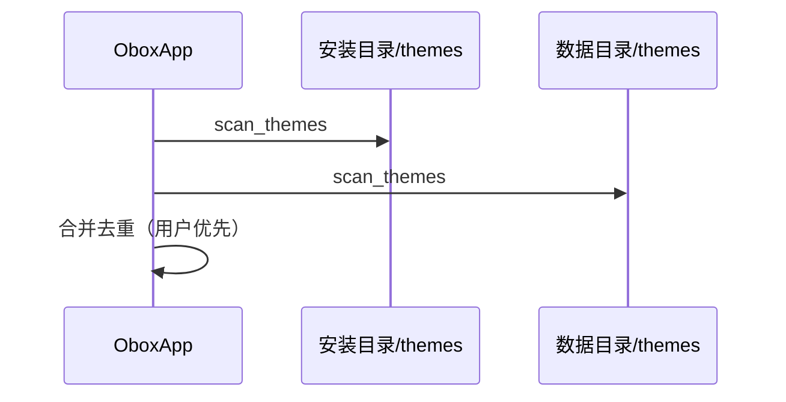
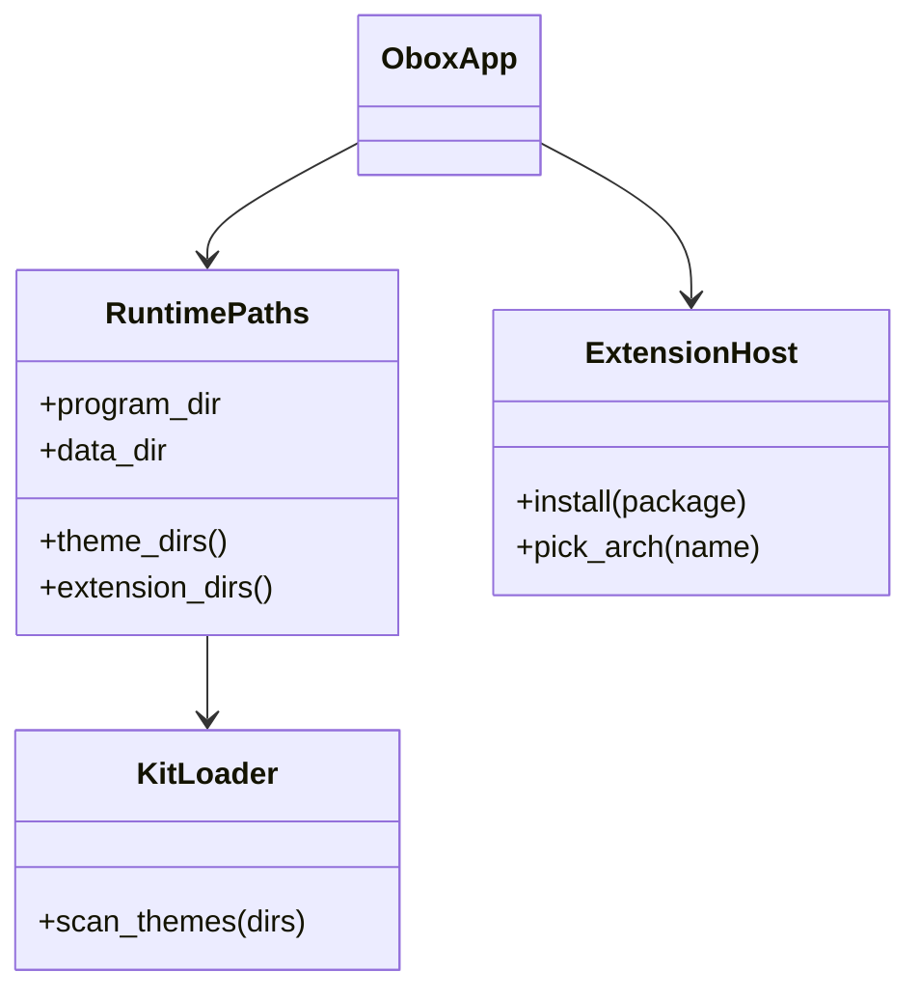

# 仓库拆分与 CI 打包发布 增量架构分析

## 变更背景

把资源从「源码目录单源」改为「安装目录 + 数据目录双源」，把发布从本机脚本改为 tag 驱动的 GitHub Actions，并按 x64/arm64 双架构产包。

## 待修改模块

| 模块 | 现有职责 | 本次改动 | 影响面 |
|---|---|---|---|
| `obox/runtime.py` | 程序目录与数据目录 | 增加 themes 双源与 installed 布局判断 | 启动路径 |
| `obox/ui/kit.py` | 扫描单个目录的套件 | 支持目录列表、去重与用户优先 | 主题列表 |
| `obox/app.py` | 主题与扩展根目录 | 用合并结果，托盘/设置同源 | 主题切换 |
| `obox/extensions/host.py` | 安装扩展包 | 按架构选择 oix | 安装流程 |
| `scripts/build_*.py` | 本机打包 | 架构后缀、themes/extensions 目录 | 产物结构 |
| `.github/workflows`（三仓） | 无 | 测试、双架构构建、Release | 发布 |

## 直接关联模块

| 模块 | 关系 | 是否要动 | 理由 |
|---|---|---|---|
| `obox/extensions/supervisor.py` | 已扫描两处扩展目录 | 否 | 现有实现已支持 |
| `obox/ui/kit.py` 的加载器 | pyd 加载 | 否 | 目录名变化不影响加载 |
| `installer/obox.nsi` | NSIS 脚本 | 是 | 要包含 themes/ 与 extensions/ |

## 接口与依赖变化

- RuntimePaths 增加 `installed_themes`、`user_themes`（或 themes_dirs 列表）。
- scan_themes 接受多个目录；重名时后者优先。
- 安装包与 oix 命名带架构后缀。
- 远端：三个仓库，PR 与 tag 触发。

## 时序图（必需）

启动扫描：

## UML 图（必需）

## 对整体架构的影响

部署形态变化：安装包自带系统主题与系统扩展；用户资源在数据目录。不新增进程与协议。CI 成为发布路径，本地脚本保留作开发用。

## 风险与回滚

| 风险 | 连带影响 |
|---|---|
| ARM runner 不可用 | ARM 构建失败；先发 x64 并在 PR 标注 |
| 双源同名冲突 | 明确用户优先并写测试 |
| 安装包缺失 themes/extensions | 首次启动无主题；构建脚本加断言 |
| CI 缓存与 Nuitka 时长 | 加缓存与超时 |