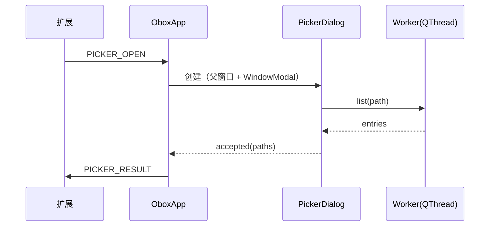
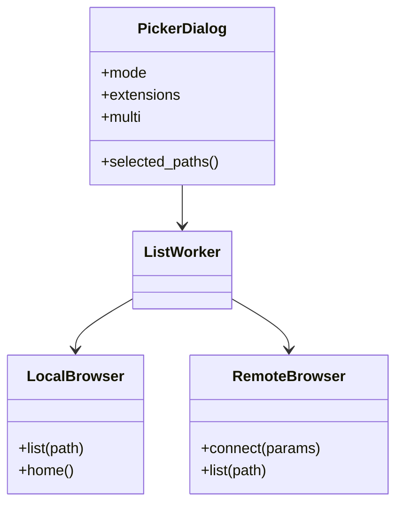

# 文件与目录选择器 增量架构分析

## 变更背景

新增扩展可用的文件/目录选择 API 与 Win11 风格对话框，支持本地与 SSH 远端；对话框只阻塞发起窗口，浏览走后台线程。需求口径见 delta-spec.md。

## 待修改模块

| 模块 | 现有职责 | 本次改动 | 影响面 |
|---|---|---|---|
| `obox/api/picker.py`（新） | 无 | PICKER_OPEN/PICKER_RESULT 与参数校验 | 新 API |
| `obox/app.py` | 消息路由、窗口管理 | 处理 PICKER_OPEN、定位窗口、模态、回结果 | 路由多一条 |
| `obox/ui/picker.py`（新） | 无 | Win11 风格对话框与本地浏览 | 新界面 |
| `obox/ui/picker_remote.py`（新） | 无 | paramiko 客户端与 QThread 工作者 | 新依赖与线程 |
| `pyproject.toml` | PySide6、matplotlib | 加 paramiko | 依赖 |
| `tests/test_picker.py`（新） | 无 | 模型、模态、SSH 假客户端 | 测试 |
| `scripts/verify_ui.py` | 场景 | 打开选择器截图 | 验证 |
| `extensions/demo` | 示例扩展 | 加「选择文件」按钮 | 示例 |

## 直接关联模块

| 模块 | 关系 | 是否要动 | 理由 |
|---|---|---|---|
| `obox/ui/main_window.py` | 主窗口 | 否 | 对话框只取窗口引用 |
| `obox/extensions/context.py` | request 能力 | 否 | 现有 request 足以等待结果 |
| `obox/ui/app_window.py` | App 窗口 | 否 | 用 window_id 找窗口 |
| `theme/*` | QSS | 是（小） | 选择器的列表/侧栏样式沿用现有选择器 |

## 接口与依赖变化

- PICKER_OPEN：src 扩展、dst obox；payload：mode、extensions、multi、title、start_path、window_id、ssh（host/port/user/password/key_path/passphrase）。
- PICKER_RESULT：src obox、dst 扩展；payload：paths（本地字符串或 {path,host,user}）、error、cancelled。
- paramiko 作为运行时依赖；线程内使用独立 Transport，关闭时释放。

## 时序图（必需）

## UML 图（必需）

## 对整体架构的影响

不新增进程；新增 API 与界面模块，paramiko 在扩展宿主或 UI 线程外的 QThread 中使用。模态范围限定在发起窗口，不改主界面结构。

## 风险与回滚

| 风险 | 影响 |
|---|---|
| 大目录枚举 | 列表卡顿；限制 5000 项并提示 |
| SSH 阻塞 | 统一放 QThread，超时 10s |
| 模态误用 | 单测断言 parent 与 windowModality |
| 依赖膨胀 | 安装包变大；可回退系统 sftp |
