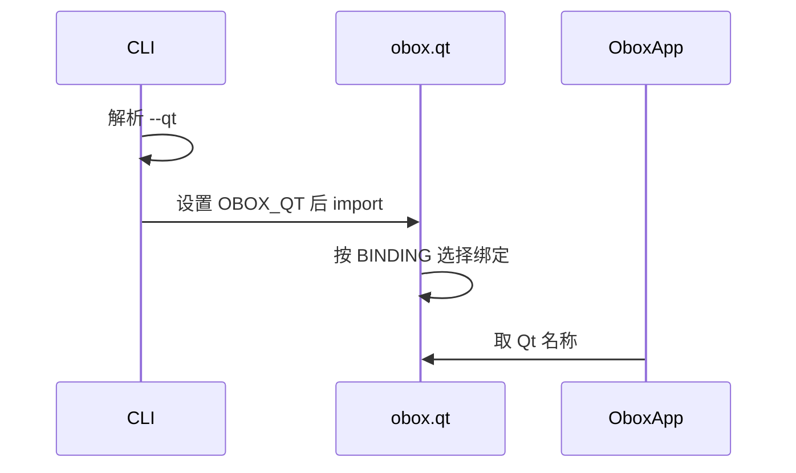
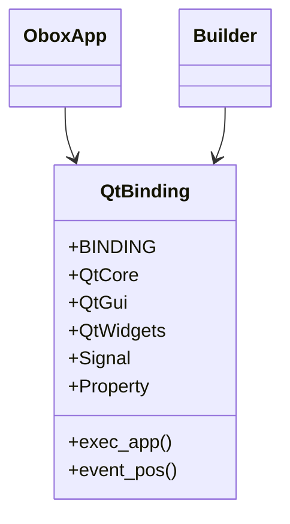

# PyQt5 与 PySide6 双绑定 增量架构分析

## 变更背景

把分散在 137 处的 PySide6 import 收敛到一个绑定层，使构建与运行时可选择 PyQt5 或 PySide6，并保证两者 UI/API 一致。

## 待修改模块

| 模块 | 现有职责 | 本次改动 | 影响面 |
|---|---|---|---|
| `obox/qt.py`（新） | 无 | 绑定选择、统一导出、差异 helper | 全项目 import |
| `obox/**`、`scripts/**`、`tests/**` | 直接 import PySide6 | 改为 obox.qt | 137 处 |
| `obox/main.py` | CLI 入口 | --qt 选择绑定 | 启动 |
| `pyproject.toml` | 依赖 | pyqt5 extra | 安装 |
| `scripts/build_*.py` | 打包 | --qt 与排除另一绑定 | 产物 |
| CI workflow | 单绑定 | binding 矩阵 | 发布 |

## 直接关联模块

| 模块 | 关系 | 是否要动 | 理由 |
|---|---|---|---|
| theme/** | 主题 pyd | 否 | 已无绑定 import |
| obox/api/** | 扩展 API | 否 | 不含 Qt 类型 |
| extensions/** | 扩展 | 否 | 只用 obox.api |

## 接口与依赖变化

- 绑定层公开：Qt 模块、Qt、Signal/Slot/Property/QAction、exec_app、event_pos/event_global_pos、icon_pixmap、version。
- OBOX_QT 环境变量与 --qt 命令行；构建脚本同名参数。
- 依赖：PySide6 默认，PyQt5 可选 extra。

## 时序图（必需）

## UML 图（必需）

## 对整体架构的影响

新增一个基础层，所有 UI 代码依赖它而非具体绑定；部署形态增加绑定维度，不新增进程。主题与扩展边界不变。

## 风险与回滚

| 风险 | 影响 |
|---|---|
| 绑定混用 | 进程崩溃；由单次选择规避 |
| Qt5 API 缺失 | 兼容 helper |
| 打包体积 | 排除另一绑定 |
