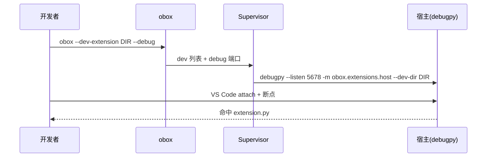
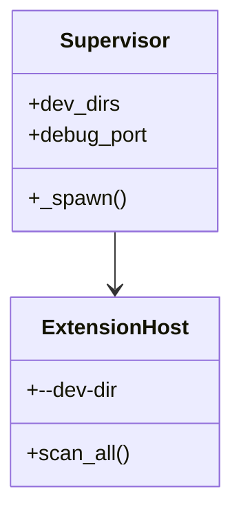

# 扩展开发调试 增量架构分析

## 变更背景

让开发目录直接挂载到运行中的 obox 并支持 debugpy 断点，不经过安装流程。

## 待修改模块

| 模块 | 改动 | 影响面 |
|---|---|---|
| obox/main.py、app.py | CLI 参数、配置、消息、watch | 启动路径 |
| supervisor.py | dev 参数与 debugpy 包装 | 宿主启动 |
| host.py、loader.py | --dev-dir 与 dev 扫描 | 扩展加载 |
| api/extensions.py | 两条 dev 消息 | 扩展管理 |
| .vscode/launch.json | 调试配置 | 开发体验 |

## 直接关联模块

| 模块 | 是否动 | 理由 |
|---|---|---|
| obox/extensions/context.py | 否 | 开发扩展用同一 context |
| 扩展管理 UI | 是（小） | 显示 origin=dev，不提供卸载 |

## 接口变化

- CLI：--dev-extension、--debug、--debug-port、--debug-wait、--no-dev-reload
- 宿主参数：--dev-dir（可重复）
- 消息：DEV_EXTENSION_ADD_MSG / DEV_EXTENSION_REMOVE_MSG，payload {path}
- 配置：dev_extensions: [绝对路径]

## 时序图

## UML 图

## 对整体架构的影响

宿主启动参数增加 dev 与 debug 包装；扫描来源增加 dev；不新增进程。

## 风险与回滚

不新增常驻进程；debugpy 仅开发期。风险：debug 时宿主阻塞等待 attach（默认），需超时提示；dev 覆盖安装需明确日志。