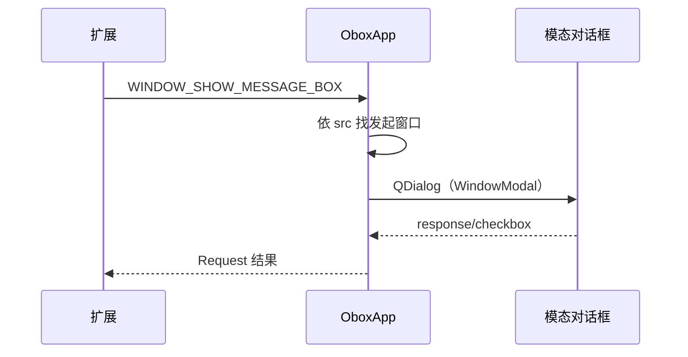
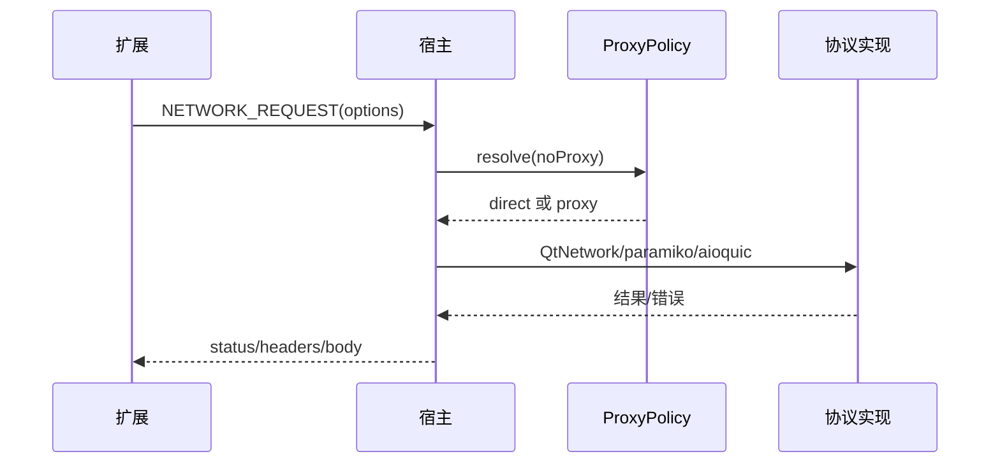
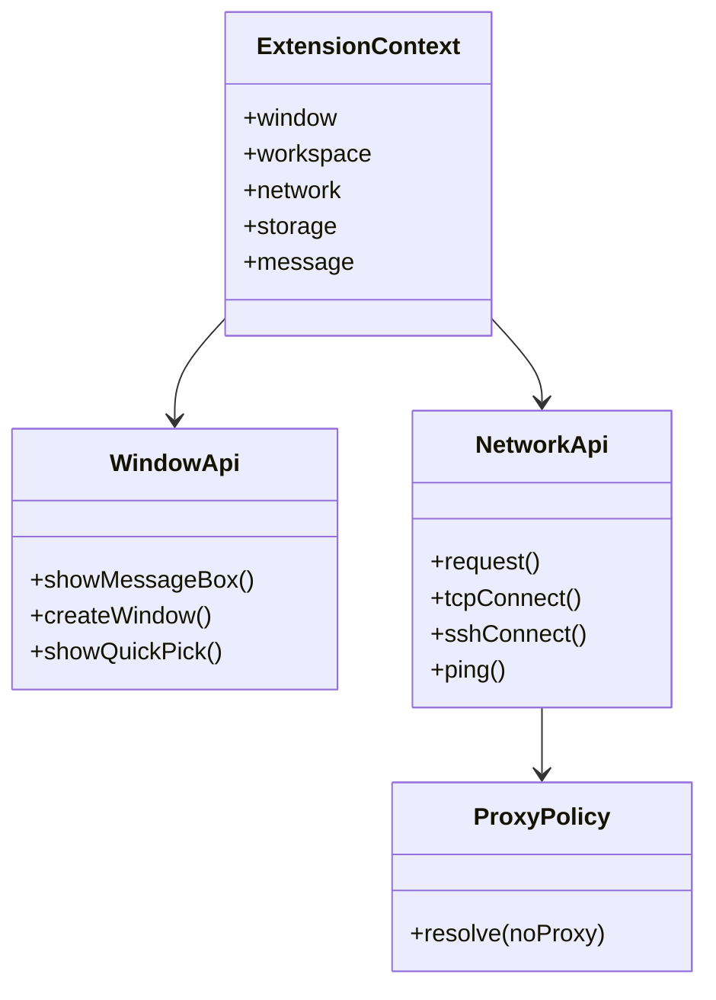

# 扩展 API 全面扩充 增量架构分析

## 变更背景

把扩展 API 从零散消息重组为 VS Code 命名空间，补 window 模态与新窗口、network 多协议与代理、storage/extensions/message/log，并同步设置页与文档。

## 待修改模块

| 模块 | 现有职责 | 本次改动 | 影响面 |
|---|---|---|---|
| obox/api/{window,workspace,commands,env,extensions,storage,network,message,log}.py | 无 | 新增命名空间消息与构造函数 | 扩展 API |
| obox/app.py | 消息路由、窗口管理 | window/命令/状态栏/进度/输出/剪贴板/shell 处理器；设置网络项 | 主进程 |
| obox/extensions/host.py | 扩展激活、事件 | network/storage/extensions/message 处理器 | 宿主 |
| obox/extensions/context.py | 注入 context | 暴露命名空间便捷属性 | 扩展开发 |
| obox/ui/statusbar.py、output_panel.py（新） | 无 | 状态栏项与输出面板 | 主窗口 UI |
| obox/extensions/network/*（新） | 无 | proxy、http、tcpudp、quic、ssh、icmp | 宿主 |
| extensions/settings | 设置页 | 网络分类与控件 | 设置 |
| pyproject | 依赖 | aioquic | 构建 |
| 测试/文档/技能 | - | 单测、verify、docs/api、ext-dev | 全部 |

## 直接关联模块

| 模块 | 关系 | 是否要动 | 理由 |
|---|---|---|---|
| obox/core/bus.py | 消息路由 | 少量 | request/reply 已够用；广播与超时复用 |
| obox/ui/app_window.py | App 窗口 | 少量 | createWindow 复用，补 modal/title |
| obox/ui/picker.py | 文件对话框 | 复用 | showOpen/SaveDialog 包装 |
| obox/api/picker.py | 已有选择器 | 保持 | window 对话框复用它 |
| obox/api/settings.py | 设置 | 扩展 | 网络设置读写与变更事件 |
| theme/** | 主题 | 否 | activeColorTheme 读运行期主题 |

## 接口与依赖变化

- 9 个命名空间，约 40 个函数；消息 id 统一 `WINDOW_*`、`WORKSPACE_*`、`COMMANDS_*`、`ENV_*`、`EXTENSIONS_*`、`STORAGE_*`、`NETWORK_*`、`MESSAGE_*`、`LOG_*`
- context 增加 `ctx.window`、`ctx.workspace`、`ctx.commands`、`ctx.env`、`ctx.extensions`、`ctx.storage`、`ctx.network`、`ctx.message`、`ctx.log`
- 依赖：aioquic（QUIC）；paramiko 已有；QtNetwork 由绑定层提供
- 设置：config.json 增加 `network.proxy`、`network.sslStrict`、`network.noProxy`

## 时序图（窗口模态）

## 时序图（网络代理）

## UML 图

## 对整体架构的影响

- API 层从零散消息变为 9 个命名空间；宿主承担网络/存储/扩展信息，主进程承担窗口与 UI
- 新增状态栏与输出面板两个 UI 容器；新增 network 服务子包
- 新增 aioquic 依赖；QUIC 不依赖 Qt 版本
- 设置页与 config 增加网络配置，代理成为全局策略

## 风险与回滚

| 风险 | 影响 | 应对 |
|---|---|---|
| aioquic 打包体积/兼容 | 安装包变大 | 仅 network.quicRequest 导入；失败返回错误 |
| 代理下 UDP/QUIC 不可用 | 协议失败 | 明确能力错误，不静默直连 |
| ICMP 无权限 | ping 失败 | 系统 ping + 错误信息 |
| 模态父窗口错配 | 阻塞错误窗口 | src→窗口映射 + 测试 |
| API 面过大 | 维护成本 | 分命名空间文档 + 类型化构造函数 |
