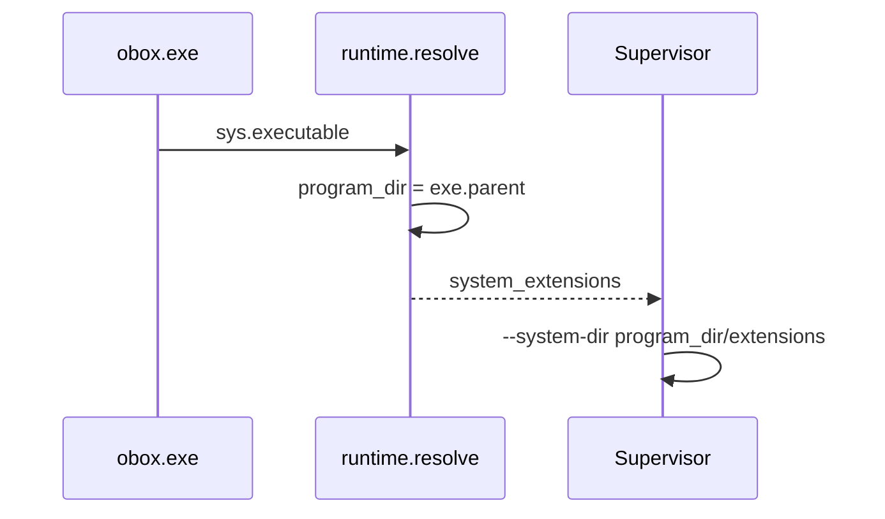
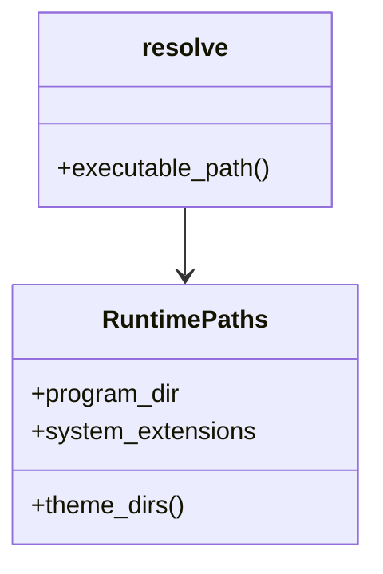

# 安装目录定位 增量架构分析

## 变更背景

安装版重启后系统扩展未加载，怀疑 program_dir 推导错误；需要以 exe 路径定位安装目录。

## 待修改模块

| 模块 | 改动 | 影响面 |
|---|---|---|
| obox/runtime.py | executable_path、is_installed、resolve | 启动路径 |
| tests/test_install_path.py | 伪造 exe 测试 | 测试 |

## 直接关联模块

| 模块 | 是否动 | 理由 |
|---|---|---|
| obox/app.py | 否 | 已使用 resolve().program_dir |
| obox/extensions/supervisor.py | 否 | --system-dir 由 program_dir 派生 |
| installer/obox.nsi | 否 | 目录结构不变 |

## 接口与依赖变化

- 新增 runtime.executable_path() 纯函数
- 无新依赖

## 时序图（必需）

## UML 图（必需）

## 对整体架构的影响

路径解析更可靠，不改变模块边界与安装布局。

## 风险与回滚

| 风险 | 应对 |
|---|---|
| python 可执行文件误判 | 名称白名单排除 |
| 特殊启动器 | OBOX_PROGRAM_DIR 覆盖 |
