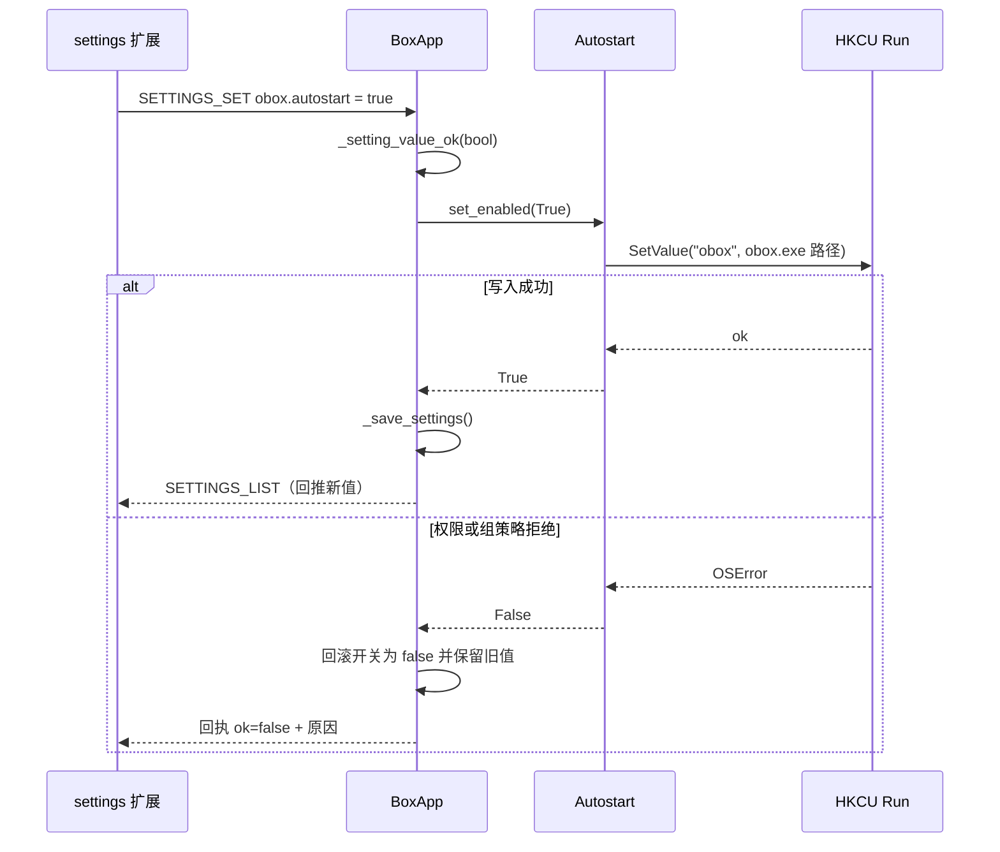
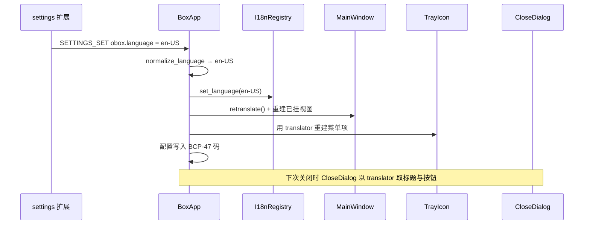
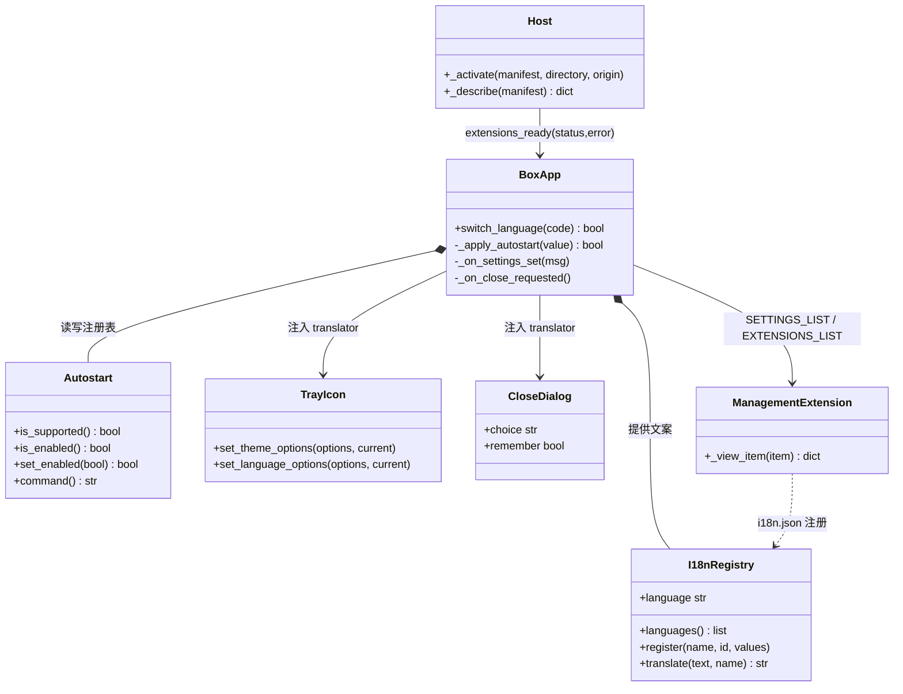

# 设置自启动与多语言 增量架构分析

## 变更背景

本次在宿主壳层补一个开机自启动开关，把托盘、关闭询问框与扩展管理页的硬编码文案收进 i18n，把语言集合从 QLocale 全量枚举收敛成四种并统一存 BCP-47 码，浅色套件主文本改纯黑，同时修掉 rdp.chenzhi 因 .oix 缺运行期模块而无法激活的缺陷，并让失败原因上浮到界面。需求细节见 `delta-spec.md`，设计与取舍见 `delta-design.md`。

## 待修改模块

| 模块 | 现有职责 | 本次改动 | 影响面 |
|---|---|---|---|
| `obox/core/autostart.py` | 不存在 | 新增：winreg 读写 HKCU Run 的 obox 值，提供 is_supported/is_enabled/set_enabled/command | 新模块，仅被 obox/app.py 调用；不依赖 Qt |
| `obox/app.py` | 设置分组、配置读写、语言切换、托盘装配、关闭流程、扩展就绪处理 | behavior 分组加 `obox.autostart` bool 项；语言改写码并迁移旧标签；失败通知带原因；构造 TrayIcon/CloseDialog 时注入 translator | 单文件；消息协议与对外信号不变 |
| `obox/i18n.py` | 文案注册、语言回退、占位替换 | 增加 SUPPORTED_LANGUAGES 常量与 normalize_language（标签→码） | 新增常量与纯函数，I18nRegistry 行为不变 |
| `obox/i18n.json` | obox 壳层文案（zh-CN/en-US） | 补 zh-HK、zh-TW，新增托盘/关闭框/通知条目 | 数据文件 |
| `obox/ui/tray.py` | 托盘菜单与主题、语言子菜单 | 构造函数接收 translator，菜单项文案按语言重建 | 信号与公开方法不变，构造参数有默认值 |
| `obox/ui/close_dialog.py` | 关闭询问对话框 | 构造函数接收 translator，标题、提示、按钮与「记住选择」取文案 | 公开属性 choice/remember 不变 |
| `extensions/management/extension.py` | 扩展列表、安装、禁用、卸载 | 状态与来源标签入 i18n；条目副标题追加失败原因 | 视图数据项多一个 error 字段 |
| `extensions/rdp/extension.py` | 远程桌面扩展入口 | `exec(fields.py)` 改为 `from fields import FIELDS` | 入口与 activate 签名不变 |
| `extensions/*/i18n.json`（app、settings、management、gallery、demo、chartdemo、pickerdemo、webapp、rdp） | 各扩展的 zh-CN/en-US 文案 | 补 zh-HK、zh-TW；补被硬编码的条目 | 数据文件 |
| `extensions/settings/extension.py` | 设置页视图注册与过滤 | 侧栏标题改为 i18n 占位符 | 单文件 |
| `obox/ui/template.py` | 绑定文本求值与 i18n 占位符跳过 | 绑定结果含占位符时按视图 owner 的命名空间替换 | 单文件，需把 owner 传进绑定 |
| `obox/ui/main_window.py` | 主窗口、侧栏按钮与 toast | 侧栏按钮标题按命名空间替换后再写 tooltip | 单文件 |
| `theme/light/theme.py`、`theme/light/styles.qss` | 浅色套件色板与样式 | TEXT 由 #1d2129 改 #000000，TEXT_MUTED 保持 #86909c | 常量与样式表，组件类不变；需重编 .theme/light |

## 直接关联模块

| 模块 | 与待改模块的关系 | 本次是否要动 | 理由 |
|---|---|---|---|
| `obox/extensions/host.py` | 产生 extensions 状态帧，条目已带 `status` 与 `error`（host.py:379-387） | 否 | 契约已满足，管理页直接消费 error |
| `obox/extensions/supervisor.py` | 拉起宿主并把 status 帧转成 extensions_ready 信号（supervisor.py:174-177） | 否 | 帧结构不变 |
| `obox/ui/modal_dialog.py` | CloseDialog 的基类，title/message/按钮文案都由构造参数传入 | 否 | 构造签名已支持外部文案 |
| `obox/ui/main_window.py` | 持有 notify_warning 与 retranslate（main_window.py:335、354） | 否 | 文案由调用方传入，本次在 app.py 侧改 |
| `scripts/pack_extension.py` | 按 import 图收集模块并打 .oix（pack_extension.py:28-53、85-118） | 否 | 规则不变；rdp 改成真 import 后自动进图 |
| `scripts/build_theme.py` | 把 theme/light 编译成 .theme/light | 否 | 只重跑构建 |
| `obox/qt.py` | Qt 绑定适配层 | 否 | 不引入新控件 |

## 接口与依赖变化

新增：

- `obox/core/autostart.py`：`is_supported() -> bool`、`is_enabled() -> bool`、`set_enabled(bool) -> bool`、`command() -> str`；全部不依赖 Qt，失败以返回值表达，不抛到调用方。
- `obox/i18n.py`：`SUPPORTED_LANGUAGES: tuple[str, ...]`、`normalize_language(value: str) -> str`（标签或码都归一到码，未知返回空串）。
- 设置项 `obox.autostart`（bool，默认 false）；配置顶层 `language` 与 `settings.obox.language` 一律存码。
- 扩展管理视图数据项新增 `error` 字段（空串表示没有原因）。

修改：

- `TrayIcon.__init__(icon, parent=None, translator=None)`、`CloseDialog.__init__(parent=None, translator=None)`；translator 缺省时回退中文原文，保证既有调用不破。
- 绑定与侧栏标题新增一个约定：扩展传来的字符串里的 i18n 占位符（双花括号包住 i18n.条目名）由宿主按该扩展命名空间替换，未注册的占位符原样保留（与现有 i18n 回退规则一致），消息协议不变。

不变：

- 消息类型与协议（SETTINGS_SET / SETTINGS_LIST / EXTENSIONS_* ）；
- 宿主与扩展的分层：api 仍不依赖 ui 与 extensions；主题套件仍不依赖 obox。

## 时序图（必需）

开机自启动从设置页到注册表：

语言切换带动壳层与托盘重建：

## UML 图（必需）

## 对整体架构的影响

无结构性影响。分层与依赖方向不变：api 仍是被两侧共享的纯契约层，core 新增的 autostart 只依赖标准库 winreg，ui 与 extensions 的依赖关系不动；部署形态不变，不新增端口、服务或后台进程，只在安装版运行时多写一处 HKCU Run；扩展分发形态不变，.oix 仍是 import 图内的 pyd 加静态资产，rdp 的入口改为真 import 后自然进图。唯一需要记入基线的例外是 D43 的边界：宿主自身开关由宿主写注册表，其它 Windows 能力仍封在扩展内。

## 风险与回滚

- 注册表写入被拒：开关回滚为 false，配置保留旧值，界面提示原因；回滚实现即删除 `obox/core/autostart.py` 与设置项。
- 语言迁移写坏配置：迁移只写顶层 `language` 与 `settings.obox.language` 两个键；回滚即删键让程序回落 zh-CN。
- 壳层文案量大（extensions/management/extension.py 与 main_window 仍有大量中文），漏改会在英文下露出中文：用键集合测试守住，逐文件清点硬编码。
- TrayIcon/CloseDialog 构造签名变化会影响测试与其它调用点：translator 给默认值，先保证旧调用通过再替换调用点。
- 主题改色导致对比度异常：重编 .theme 后用 `uv run python scripts/verify_ui.py` 出 light/dark 截图回归。
