# obox 系统架构设计文档

| 项目 | 内容 |
|---|---|
| 文档版本 | v1.0 |
| 编写人 | obox 团队 |
| 评审人 | 待评审 |
| 最后更新 | 2026-11-20 |
| 文档状态 | 草稿 |
| 文档密级 | 内部公开 |

## 变更记录

| 版本 | 日期 | 修改人 | 变更说明 |
|---|---|---|---|
| v1.0 | 2026-11-20 | obox 团队 | 初稿，覆盖界面框架、消息通道与扩展系统 |

## 1. 引言与背景

### 1.1 编写目的

本文档描述 obox 的整体架构：系统边界、模块分层、核心链路、消息模型、进程拓扑与非功能设计，作为开发、测试与后续演进的技术依据。

| 读者 | 建议章节 | 关注重点 |
|---|---|---|
| 技术决策者 | 1、2、9 | 建设目标、约束条件、演进节奏与风险 |
| 扩展开发者 | 3、5、6 | 扩展边界、消息契约与清单约定 |
| 开发团队 | 2、4、5、10 | 分层职责、技术选型、核心链路与模型 |
| 测试团队 | 5、8 | 异常链路、性能与稳定性指标 |

### 1.2 业务背景

obox 的定位是「可扩展的桌面工作台」：主程序负责窗口、导航、主题与运行时能力，具体功能由第三方的扩展贡献。当前工程处于地基阶段，只有入口脚本与空的 README，界面框架、进程通道与扩展体系都还没有落地。若不先把三者的边界与契约定清，后续每加一个组件或一个扩展都会反复改动消息格式与加载流程。

### 1.3 核心目标

| 编号 | 目标 | 量化指标 | 验证方式 |
|---|---|---|---|
| G1 | 扩展可交付带界面的功能 | 从空目录到可点击扩展视图不超过 4 个文件 | 示范扩展与端到端演示 |
| G2 | 组件交互低延迟 | 本机事件往返 P95 低于 50ms | 事件打点与压测脚本 |
| G3 | 通道稳定 | 宿主崩溃后 5 秒内恢复并重新激活 | 杀进程演练 |
| G4 | 组件可扩展 | 新增一个组件只改注册表与一个组件文件 | 代码评审与新增组件检查 |

### 1.4 术语表

| 术语 | 全称 | 说明 |
|---|---|---|
| 扩展 | extension | extensions 目录下的一个子目录，含清单、入口与资产 |
| 扩展标识 | extension id | 形如 名称.作者，消息里的 src 与 dst 使用该格式 |
| 组件消息 | component message | 事件、状态查询与状态修改三类消息的合称 |
| 返程 | reply | 消息的应答，复用原消息类型并把 reply 置为真 |
| 关联 id | correlation id | 请求与应答共用的唯一标识 |
| 宿主 | extension host | 承载全部扩展激活的子进程 |

## 2. 架构设计原则与约束

### 2.1 设计原则

- **原生优先**：界面由 Qt 原生控件与自绘图元渲染，不引入 Web 引擎；HTML 只是声明，不是运行时。
- **契约先行**：obox 与扩展之间只通过消息与清单交互，扩展不直接触碰 obox 内部对象。
- **隔离可度量**：组件 id 按扩展命名空间隔离，样式按选择器白名单隔离，越权即拒绝并留痕。
- **失败不外溢**：单个扩展的激活异常不影响其他扩展；宿主崩溃由 obox 兜底重启。
- **可等待**：所有需要应答的请求都能被同步等待或异步等待，避免回调地狱。

### 2.2 约束条件

| 类型 | 约束 | 对架构的影响 |
|---|---|---|
| 技术栈 | Python 3.12、PySide6 | 主程序与宿主都依赖 QtCore，界面组件用 QWidget 与自绘 |
| 平台 | 当前只验收 Windows | 进程通道选命名管道，路径与进程管理按 Windows 处理 |
| 通信 | 不得使用网络端口 | 排除 TCP/UDP 方案，只能用本地命名管道或共享内存 |
| 组件库许可 | 免费版为 GPLv3 | 闭源分发前需换授权或替换组件库 |
| 扩展来源 | 只读本地目录，不做签名 | 信任模型是本机可信代码，安全边界靠进程隔离 |

## 3. 业务架构与系统上下文

### 3.1 系统上下文图
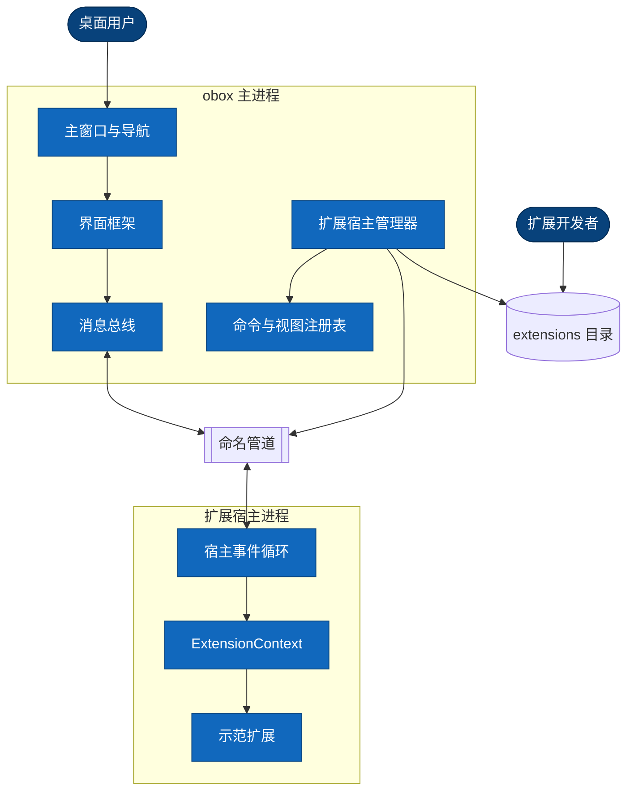

**外部依赖说明**：

| 依赖 | 交互方式 | 依赖强度 | 故障影响与应对 |
|---|---|---|---|
| extensions 目录 | 启动时扫描、清单校验 | 强 | 目录缺失时以空扩展集启动并提示 |
| 命名管道 | 双向帧传输 | 强 | 断开即判定宿主失效，重启宿主并重建通道 |

### 3.2 业务能力全景图
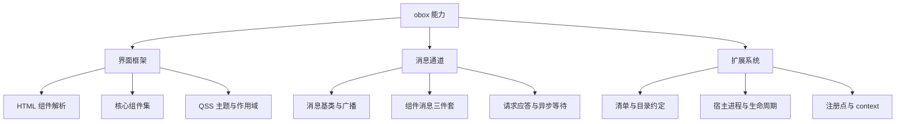

### 3.3 能力划分

| 能力 | 核心职责 | 承载模块 | 主要依赖 |
|---|---|---|---|
| 界面框架 | 把 HTML 片段装配成原生控件，维护组件注册表与样式 | obox/ui | obox/api、PySide6 |
| 模板引擎 | o-for/o-if 与值绑定、视图数据与局部更新 | obox/ui/{expr,template}.py | obox/ui |
| 应用页 | 系统扩展 extensions/app 提供网格，obox 管理应用窗口 | obox/ui/app_window.py、obox/app.py | 扩展宿主、模板引擎 |
| 设置 | 系统扩展 extensions/settings 渲染两栏设置页；obox 汇总内置项与扩展配置并持久化 | obox/app.py、obox/api/settings.py | 扩展宿主、模板引擎 |
| Agent 技能 | .agents/skills 下四个技能与脚本，覆盖扩展、主题、界面验证、测试 | .agents/skills | scripts/、codespec |
| 安装包 | Nuitka standalone + NSIS；程序目录含 .theme 与系统扩展，数据目录在 LOCALAPPDATA | scripts/build_exe.py、build_installer.py、installer/obox.nsi | obox/runtime.py |
| 托盘与单实例 | 按用户命名管道互斥与唤醒；托盘菜单；关闭询问/最小化/退出 | obox/ui/single_instance.py、tray.py、close_dialog.py、obox/app.py | 设置服务 |
| i18n 注册表 | 按扩展标识与条目 id 存多语言文案，渲染前替换占位符 | obox/i18n.py | obox/api、obox/core |
| OML 视图 | 读取扩展目录下的 .oml，拒绝越界与缺失 | obox/oml.py | 文件系统 |
| 消息通道 | 路由消息、维护关联、承载进程间帧 | obox/core、obox/api | QtNetwork |
| 扩展系统 | 发现、校验、激活扩展，管理宿主进程与注册点；支持 dev 目录与 debugpy 启动 | obox/extensions | obox/api、obox/core |
| 开发调试 | --dev-extension 目录挂载、dev 来源扫描、热重载、debugpy attach | obox/app.py、obox/extensions/{host,supervisor}.py | debugpy（dev）、QFileSystemWatcher |

扩展宿主启动时可带开发目录与调试包装：supervisor 把 --dev-dir 传给宿主，宿主按 dev 来源激活（不安装）；--debug 时宿主命令改为 debugpy 监听 127.0.0.1:5678，等待 VS Code attach。开发目录变化由 QFileSystemWatcher 触发宿主重启。

## 4. 逻辑架构与技术选型

### 4.1 分层与模块架构图
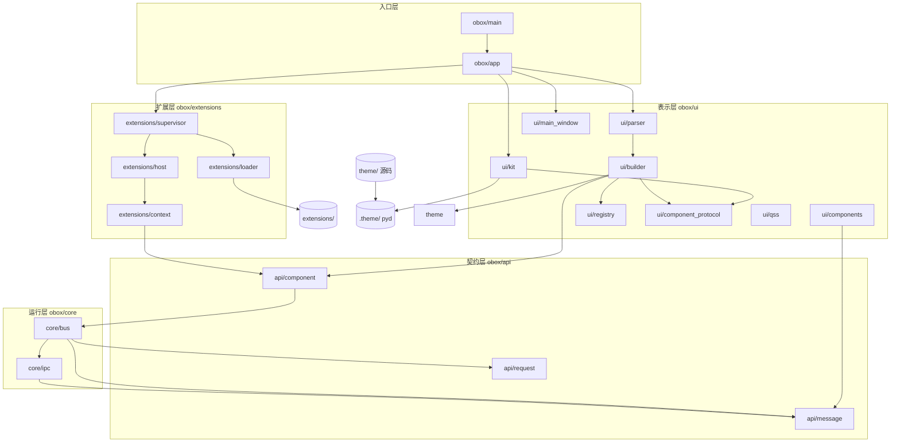

各层职责与约束：

| 层级 | 职责 | 关键约束 |
|---|---|---|
| 入口层 | 装配应用、主窗口与宿主生命周期 | 只做组装，不放业务逻辑 |
| 表示层 | 解析、装配、组件实现与样式 | 组件只认 id 与状态，不感知扩展进程 |
| 契约层 | 消息模型、组件消息与请求对象 | 纯 Python 数据结构，主程序与宿主都能导入 |
| 运行层 | 路由、关联、进程帧编解码 | 不引入界面依赖，便于单测 |
| 扩展层 | 扫描、校验、宿主进程与 context | 宿主进程入口独立，可单独拉起 |

### 4.2 核心技术栈选型表

| 类别 | 选型 | 选型理由 |
|---|---|---|
| 语言 | Python 3.12 | 与 .python-version 一致，扩展开发门槛低 |
| GUI | PySide6 | Qt 官方绑定，QLocalSocket 与 QWidget 齐备 |
| 组件实现 | 纯 Qt 控件与自绘 | 外观完全由套件掌控，不引入第三方组件库 |
| 进程通道 | QLocalServer 与 QLocalSocket | Windows 上即命名管道，无端口 |
| 序列化 | 标准库 json | 可读、易调试，帧头标注长度 |
| 打包 | Nuitka | 把 theme 套件编译为 pyd |
| 主题套件 | light 与 dark 各自独立实现 | 组件实现与主题一起放进 .theme，按配置加载 |
| 扩展打包 | Nuitka 逐文件编译 + zip | 产物 .oix 放 dist/，安装到 .obox/extensions |
| 测试 | pytest 与 pytest-qt | 覆盖解析、编解码与生命周期 |

### 4.3 关键架构决策与取舍

决策的完整理由与被否方案见 codespec/specs/design.md 的 Decisions 章节，此处只列索引。

| 决策点 | 选择 | 主要代价 |
|---|---|---|
| D1 渲染栈 | Qt 原生控件与自绘承载 HTML DSL | 复杂布局与富文本能力受限 |
| D2 进程通道 | QLocalServer 与 QLocalSocket 命名管道 | 需要自己做帧与断线重连 |
| D3 进程模型 | 单一扩展宿主进程 | 一个扩展崩溃影响全部扩展 |
| D4 消息方向 | 事件由 obox 发、状态与修改由扩展发 | 两个方向的校验规则不同 |
| D5 异步 | 自建 Future，阻塞、回调、await 三形态 | 需要自己管理关联与超时 |
| D6 样式 | 全局主题加扩展级 QSS 白名单 | 复杂选择器可能被误拒 |
| D7 视图承载 | 主区域进内容栈、侧栏放图标、底部栏第三个注册区 | 容器类型固定为三种，扩展自建容器要后续版本 |
| D9 握手 | 一次性 token 加协议版本 | 每次重启宿主都要重新握手 |
| D10 错误语义 | 错误码随应答 payload 返回 | 客户端要按错误码分支而不是异常类型 |
| D11 模块布局 | api、core、ui、extensions 四子包 | 新增模块要同步维护打包清单 |
| D12 主题套件 | 组件实现独立成 kit，编译为 pyd，按配置加载 | pyd 无法卸载，切换后旧模块常驻内存 |
| D13 事件订阅 | 片段写 on_ 属性才订阅 | 扩展需显式声明，漏写就没有事件 |
| D14 弹性布局 | 套件提供 Flex 容器与自定义 QLayout | 布局由我们计算，不依赖 Qt 盒子嵌套 |
| D15 扩展打包 | 逐文件编 pyd，装 sys.path，打 zip 成 .oix | 兄弟模块同名会冲突，需前缀约束 |
| D16 侧栏图标 | 按 alpha 蒙版重染为单色，选中用强调色 | 多色图标会变成剪影 |
| D17 自绘标题栏 | 无边框窗口 + 自绘标题栏 + 边缘缩放 + DWM 阴影 | 最大化时需自行处理任务栏边界 |
| D18 模板指令 | o-for/o-if + 双花括号绑定 + 区域级局部更新 | 绑定只支持点路径与简单比较 |
| D19 应用窗口 | 按 app_id 复用，single/persistent 控制 close 行为 | 持久化只保留窗口，不序列化状态 |
## 5. 核心业务流程

### 5.1 启动与扩展激活
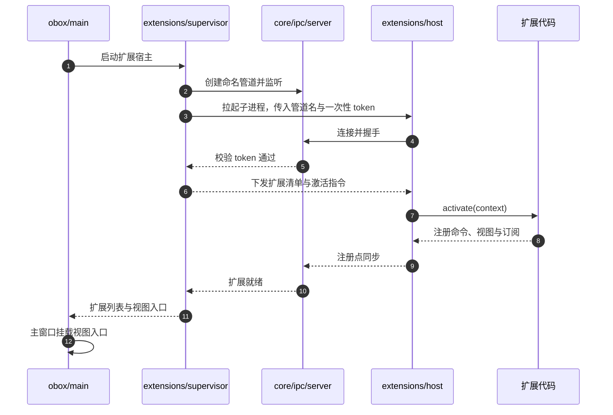

**关键点说明**：

- 握手必须先于激活，避免扩展在通道可用前发送消息。
- 注册点同步走同一条通道，obox 侧据此填充命令与视图注册表。

### 5.2 组件事件与状态修改往返
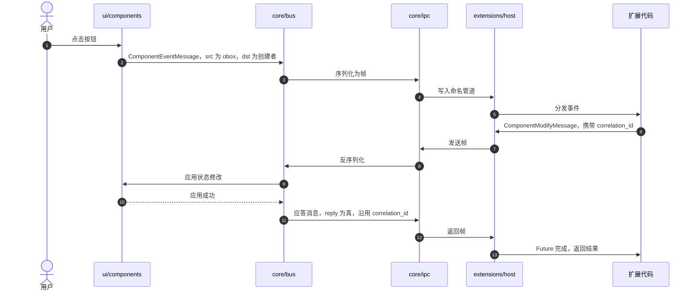

### 5.3 关键异常与补偿

| 异常场景 | 检测方式 | 补偿与降级 | 用户感知 |
|---|---|---|---|
| 扩展 activate 抛异常 | 宿主捕获并回传失败原因 | 标记该扩展失败，继续激活其他扩展 | 扩展列表显示失败标记 |
| 宿主进程崩溃 | 管道断开与进程退出码 | 重启宿主并重新激活全部扩展 | 顶部提示条显示恢复中 |
| 应答超时 | 关联表到期 | 以超时错误结束请求，清理关联 | 扩展拿到异常，界面不冻结 |
| 组件 id 冲突 | 注册表插入失败 | 拒绝创建，返回冲突错误 | 扩展日志给出冲突 id |
| 越权修改组件 | 归属校验失败 | 拒绝修改并记录 | 目标组件不变 |

## 6. 核心数据架构

### 6.1 消息模型类图
```mermaid
classDiagram
    class Message {
        +str src
        +str dst
        +str msg_id
        +bool reply
        +str correlation_id
        +dict payload
        +to_dict()
        +from_dict(data)
    }

    class ComponentEventMessage {
        +str id
        +str event
    }

    class ComponentStateMessage {
        +str id
        +str state_type
        +Any value
    }

    class ComponentModifyMessage {
        +str id
        +str state_type
        +Any value
    }

    class PendingRequest {
        +str correlation_id
        +float deadline
        +Future future
        +resolve(payload)
        +timeout()
    }

    class MessageBus {
        +str local_id
        +send(message)
        +broadcast(message)
        +request(message, timeout)
        +on(msg_id, handler)
    }

    Message <|-- ComponentEventMessage
    Message <|-- ComponentStateMessage
    Message <|-- ComponentModifyMessage
    MessageBus --> PendingRequest : 维护关联表
    MessageBus ..> Message : 路由
```

### 6.2 关键数据结构

| 结构 | 归属 | 内容 | 生命周期 |
|---|---|---|---|
| 组件注册表 | obox/ui/registry | 扩展命名空间到组件 id 与控件实例的映射 | 绑定视图，视图销毁时清理 |
| 关联表 | obox/core/bus | correlation_id 到 PendingRequest 的映射 | 请求发出到应答或超时 |
| 消息订阅表 | obox/core/bus | msg_id 到处理函数列表 | 订阅注册到注销 |
| 命令注册表 | obox/extensions | 命令 id 到扩展与处理函数 | 扩展激活到停用 |
| 视图注册表 | obox/extensions | 视图 id 到容器与 HTML 片段来源 | 扩展激活到停用 |

### 6.3 数据一致性与顺序

- **帧顺序**：同一条管道上的帧按写入顺序处理，单连接顺序即消息顺序。
- **请求唯一**：每个请求的 correlation_id 由发送方生成，应答必须原样带回。
- **广播无应答**：dst 为空的广播不进入关联表，发送方不能等待其结果。
- **幂等**：状态修改重复到达时结果一致，组件只保留最后一次值。

## 7. 物理部署与运行架构

### 7.1 进程拓扑图
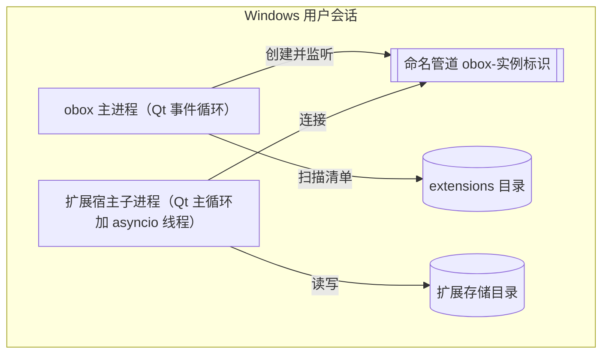

### 7.2 运行环境

| 环境 | 用途 | 形态 | 备注 |
|---|---|---|---|
| 开发 | 日常开发与调试 | 源码运行，单实例 | 虚拟环境内安装 PySide6 |
| 验证 | 端到端演示与回归 | 源码运行，含示范扩展 | 与开发同构，扩展集固定 |

### 7.3 安全边界

- **进程边界**：扩展代码只在宿主进程执行，主程序不在扩展代码路径上暴露内部对象。
- **通道边界**：管道名带实例标识与随机后缀，握手校验一次性 token，拒绝陌生连接。
- **控件边界**：扩展只能操作自己命名空间下的组件，越权直接拒绝。
- **样式边界**：扩展 QSS 经过选择器白名单过滤后才会被应用。

### 7.6 资源目录与双架构产物

- 运行期资源：安装目录 themes/ 与 extensions/ 提供系统主题与系统扩展；数据目录 themes/ 与 extensions/ 提供用户覆盖与安装的扩展；同名时用户目录优先，源码态开发沿用 .theme 与 extensions/。
- 构建产物：主题编译为 themes/{name}/{name}.pyd 目录，系统扩展（app、settings、management）编译为 extensions/{id}/extension.pyd 目录，随 NSIS 安装包分发；用户扩展独立仓产 oix，按 x86_64/arm64 各一份。
- 发布：PR 跑测试与打包冒烟；v 开头 tag 触发矩阵构建并上传 Release。

## 8. 非功能性需求设计

### 8.1 稳定性与容错

| 风险场景 | 应对措施 | 目标 |
|---|---|---|
| 扩展 activate 抛异常 | 宿主逐个隔离激活结果 | 其他扩展不受影响 |
| 宿主崩溃 | 进程监控加自动重启 | 5 秒内恢复 |
| 管道半包与粘包 | 帧头长度校验与缓冲拼接 | 不丢消息、不错位 |
| 应答丢失 | 关联表超时兜底 | 请求不会永久挂起 |

### 8.2 性能

| 场景 | 实测或目标 | 手段 |
|---|---|---|
| 组件事件往返 | 实测约 16ms（本地，含 5ms 轮询粒度） | 单连接直发，避免多次序列化 |
| 首屏装配 | 实测 1 秒内完成扩展视图挂载 | 解析与装配分离，控件延迟创建 |
| 主题套件加载 | 实测约 80ms 每套，两套合计约 160ms | Nuitka 编译产物，导入即用 |
| 消息吞吐 | 目标每秒 2000 条以上，尚未压测 | JSON 小载荷，必要时换二进制编码 |

### 8.3 安全性

- 扩展被视为本机可信代码，v1 不做签名校验，靠进程隔离限制影响面。
- 管道连接需要 token，防止同机其他进程冒充宿主。
- 清单里的图标与 QSS 路径必须落在扩展自己的 assets 目录内，拒绝路径穿越。

### 8.4 可观测性

| 维度 | 位置 | 内容 |
|---|---|---|
| 日志 | obox 主进程与宿主进程 | 扩展激活结果、消息错误、样式拒绝原因 |
| 指标 | 内存计数 | 待应答请求数、消息速率、组件数 |
| 诊断 | 命令与视图注册表快照 | 排查注册点缺失与冲突 |
## 9. 架构演进与风险评估

### 9.1 演进路线图

| 阶段 | 时间窗 | 架构形态 | 关键动作 | 验证指标 |
|---|---|---|---|---|
| 一期 | 当前变更 | 单宿主进程加核心组件 | 三块地基跑通，示范扩展可用 | 端到端演示通过 |
| 二期 | 后续变更 | 组件全量化、注册点扩展 | 补齐表格与表单类组件，扩充菜单注册点 | 组件覆盖率提升 |
| 三期 | 远期 | 按扩展分包与权限模型 | 每扩展独立进程、签名与权限声明 | 崩溃隔离与安全审计 |

### 9.2 潜在风险与应对

| 风险项 | 触发条件 | 影响 | 应对措施 |
|---|---|---|---|
| 组件库许可 | 闭源分发 | 无法合法分发 | 商业授权或替换组件库 |
| 单宿主崩溃 | 扩展段错误或死循环 | 全部扩展不可用 | 自动重启并限制激活超时 |
| DSL 表达力不足 | 复杂布局需求 | 扩展体验受限 | 逐次补充组件与属性 |
| 样式过滤误判 | 复杂选择器 | 扩展样式失效 | 记录拒绝原因，提供调试命令 |

### 9.3 技术债务台账

| 债务项 | 来源 | 影响 | 偿还计划 |
|---|---|---|---|
| 单宿主进程 | 一期简化 | 崩溃影响面大 | 三期拆分为按扩展分包 |
| JSON 序列化 | 一期求快 | 高频消息 CPU 占用高 | 有压测数据后评估二进制编码 |
| 扩展不做签名 | 一期简化 | 恶意扩展无拦截 | 三期引入签名与权限声明 |

## 10. UML 视图

| 视图 | UML 类型 | 所在章节 | 主要读者 |
|---|---|---|---|
| 用例图 | Use Case | 10.1 | 产品、测试 |
| 类图 | Class | 10.2 | 开发 |
| 状态机图 | State Machine | 10.3 | 开发、测试 |
| 活动图 | Activity | 10.4 | 开发、测试 |
| 组件图 | Component | 10.5 | 开发、运维 |

### 10.1 用例图
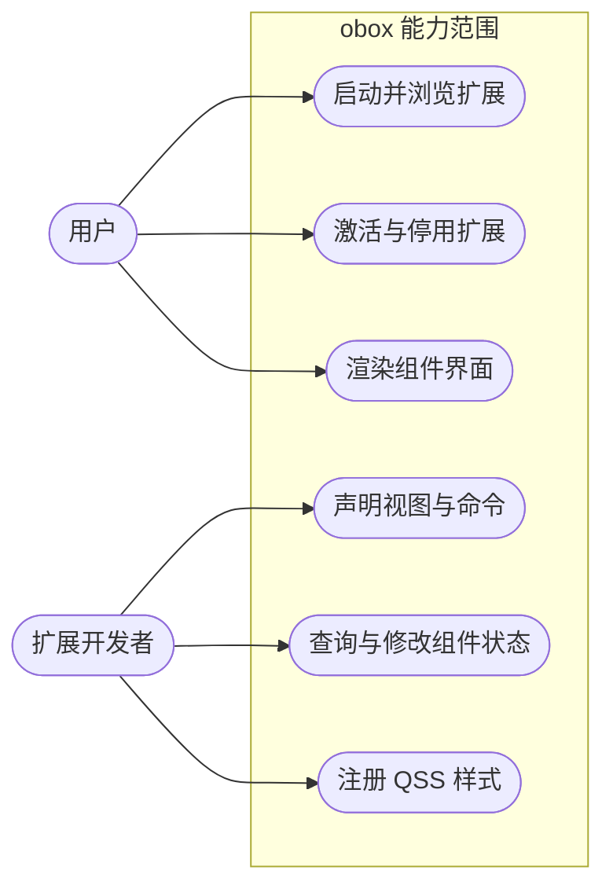

### 10.2 类图

与 6.1 的消息模型互补，这里补充组件、注册表与 context 的关系。

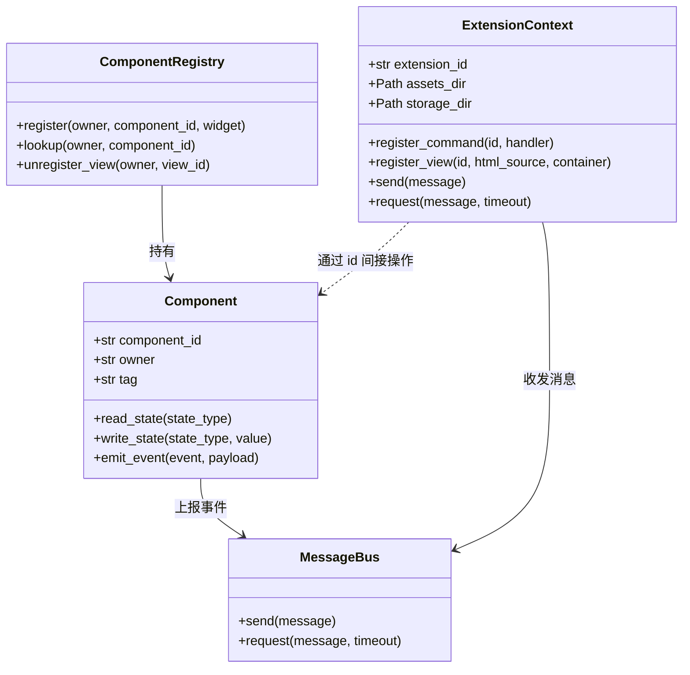

### 10.3 状态机图
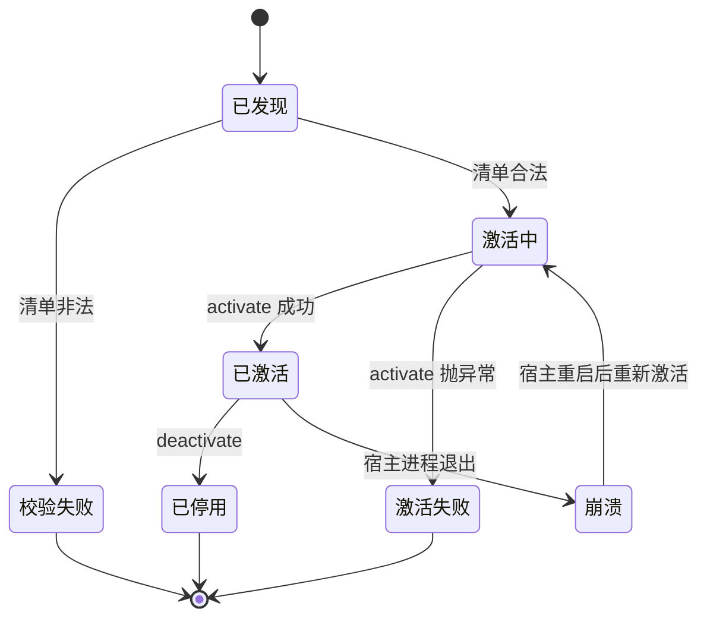

### 10.4 活动图
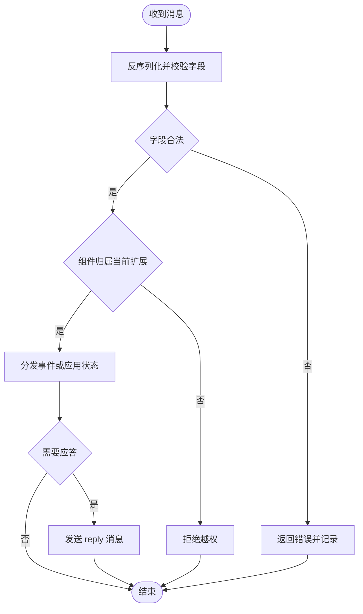

### 10.5 组件图
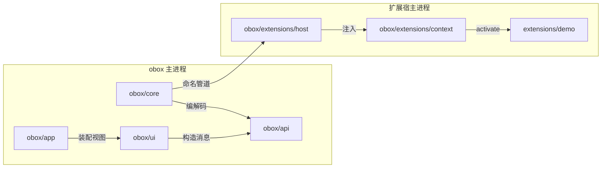

## 附录

### A. 参考资料

- Qt for Python 文档：https://doc.qt.io/qtforpython/
- Ant Design 组件总览：https://ant.design/components/overview-cn/
- Visual Studio Code 扩展清单：https://code.visualstudio.com/api/references/extension-manifest
- Visual Studio Code 注册点：https://code.visualstudio.com/api/references/contribution-points

### B. 架构评审自查清单

- [ ] 每个核心目标都有可量化指标与验证方式
- [ ] 进程拓扑与真实运行方式一致，断线与崩溃路径明确
- [ ] 消息契约同时覆盖单向通知与请求应答，超时与拒绝路径清晰
- [ ] 组件 id、样式与权限三个隔离面都有拒绝策略
- [ ] 每项关键选型都写明了被否的替代方案
- [ ] 演进路线与一期的能力边界一致，不承诺超出资源的范围